# DepthAI.Net Gallery

A desktop app (Avalonia) that shows what an OAK camera can do in the field: 14 real use cases
from industry, offices, education, security, retail, entertainment, and smart cities. Each use
case runs a public Luxonis Model Zoo model **inside the camera**, shows the result, and comes
with C# code you can copy as is.

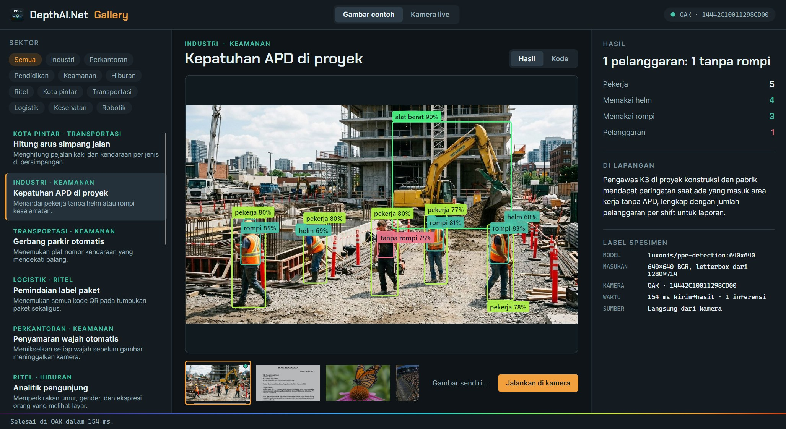

```bash
dotnet run --project src/DepthAI.Net.Gallery
```

The UI is in Indonesian, like the rest of the tooling; the table below gives English names.

## Two image sources

**Sample images.** The app sends the image to the camera through a `HostInputNode`, the neural
network on the OAK analyses it, and the result comes back to the screen. While the camera works,
a Turbo-coloured scan line sweeps the image; annotations appear when the answer arrives. **Gambar
sendiri…** (your own image) runs the same model on a photo of yours.

**Live camera.** The same model runs on the camera preview. The frame shown is the `passthrough`
frame that was actually inferred on, so boxes always line up with the picture. Results per
second are shown in the corner of the stage.

**Without a camera**, the gallery shows results recorded from a real OAK-1
(`Samples/recorded.json`), with the device MxId and recording time on the *specimen label*.
Nothing is made up: an image that was never recorded is shown without annotations.

The sample images were made with a generative model (Nano Banana 2 through Rodin). The people,
licence plates, and documents in them are fictional.

## Use cases

Figures come from an OAK-1 (MxId `14442C10011298CD00`, USB 3, Windows). "Image" is send-to-result
time, including USB transfer and host-side decoding. "Live" is results per second on the camera
preview.

| Use case (UI title) | Sectors | Model | Result on the sample image | Image | Live |
| --- | --- | --- | --- | --- | --- |
| Intersection traffic count (*Hitung arus simpang jalan*) | Smart city, Transport | `yolov6-nano:r2-coco-512x288` | 9 pedestrians, 6 vehicles | 64 ms | 15/s |
| Site PPE compliance (*Kepatuhan APD di proyek*) | Industry, Security | `ppe-detection:640x640` | 1 violation: 1 without vest | 157 ms | 8/s |
| Automatic parking gate (*Gerbang parkir otomatis*) | Transport, Security | `license-plate-detection:640x640` | 2 plates ready to read | 206 ms | 8/s |
| Parcel label scanning (*Pemindaian label paket*) | Logistics, Retail | `qrdet:nano-512x288` | 4 QR codes found | 86 ms | 15/s |
| Automatic face anonymisation (*Penyamaran wajah otomatis*) | Office, Security | `yunet:640x480` | 4 faces pixelated | 121 ms | 15/s |
| Audience analytics (*Analitik pengunjung*) | Retail, Entertainment | YuNet + `age-gender-recognition` + `emotion-recognition` | 5 viewers, mixed expressions | 1047 ms | 4/s |
| Movement and posture coach (*Pelatih gerak dan postur*) | Education, Health | `yolov8-nano-pose-estimation:coco-512x288` | 1 lunge, 1 arms up, 1 squat | 71 ms | 15/s |
| Workspace inventory (*Inventaris ruang kerja*) | Office, Robotics | `yolov8-instance-segmentation-nano:coco-512x288` | 4 chairs, 2 people, 2 plants, 1 dog | 106 ms | 15/s |
| Scene understanding (*Pemahaman adegan*) | Robotics, Transport | `deeplab-v3-plus:256x256` | Seen: person, car | 154 ms | 10/s |
| Virtual meeting background (*Latar virtual konferensi*) | Entertainment, Office | `mediapipe-selfie-segmentation:256x144` | Background replaced | 35 ms | 20/s |
| Crowd density (*Kepadatan kerumunan*) | Smart city, Security | `dm-count:shb-426x240` | About 227 people, densest in the middle | 1462 ms | 1.3/s |
| Document digitisation (*Digitalisasi dokumen*) | Office, Education | `paddle-text-detection:320x576` | 14 text lines | 174 ms | 8/s |
| Learn-by-pointing recognition (*Kenali objek untuk belajar*) | Education, Retail | `efficientnet-lite:lite0-224x224` | monarch (82 %) | 111 ms | 15/s |
| Touchless kiosk (*Kios tanpa sentuh*) | Health, Entertainment | `mediapipe-palm-detection:192x192` | Palm detected | 49 ms | 20/s |

Live rates are capped by the camera FPS chosen per use case (2–20 fps), so they are a lower
bound on what each model can do, not an upper one.

### Intersection traffic count

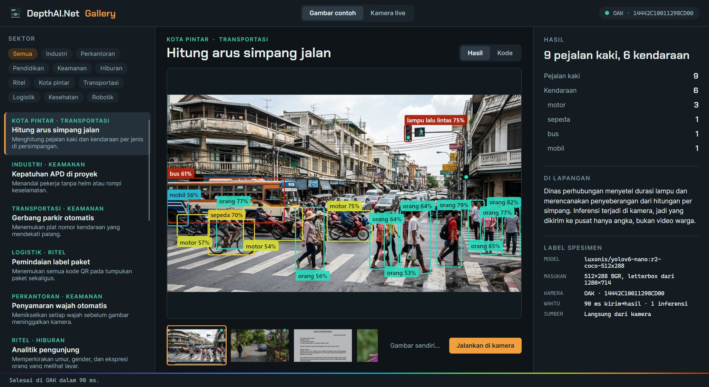

Traffic departments tune signal timing from per-junction counts. Only numbers leave the camera,
never video of residents.

### Site PPE compliance

Safety officers are alerted when someone enters a work area without a hard hat or vest. Green
boxes mean PPE worn, red means a violation (image at the top of this page).

### Automatic parking gate

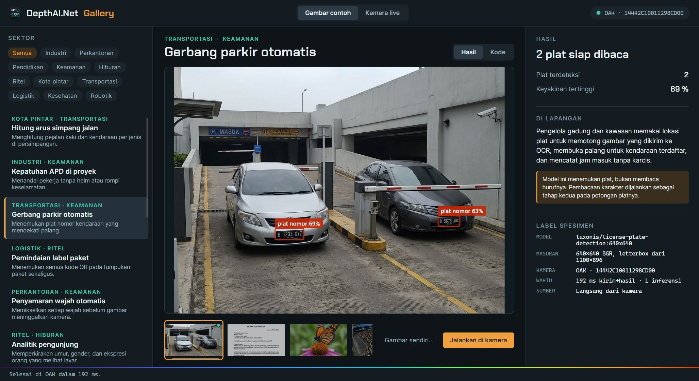

The model finds plates; reading the characters is a second OCR stage on the plate crop.

### Parcel label scanning

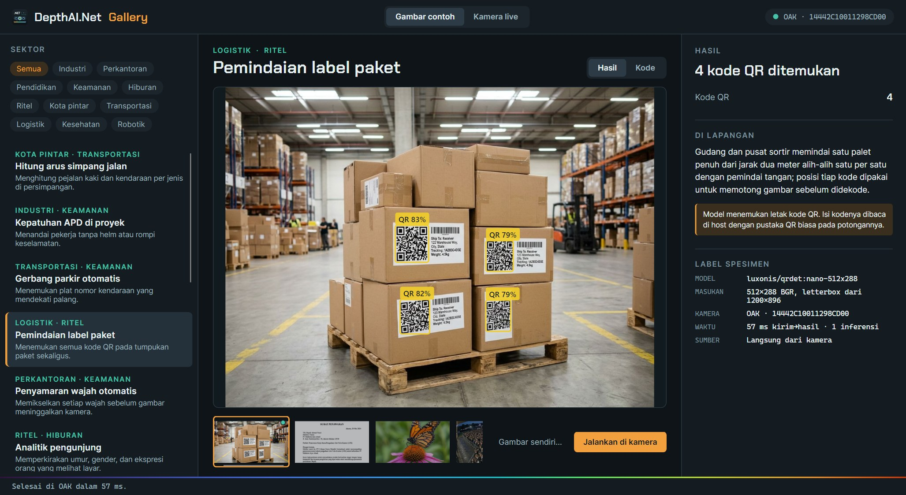

A whole pallet is scanned from two metres away. The model locates QR codes; their content is
read on the host with an ordinary QR library.

### Automatic face anonymisation

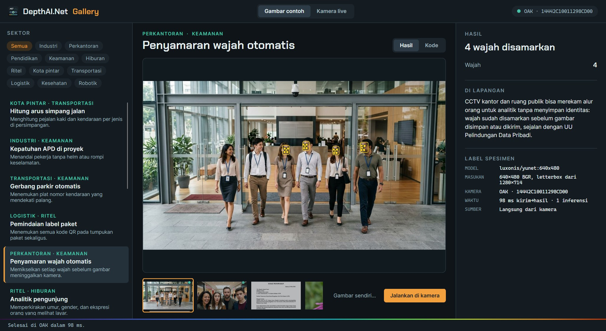

Faces are pixelated before the image is stored or sent. In the lobby image YuNet finds 4 of the
6 small faces; that is the limit of a 640×480 model for distant faces.

### Audience analytics

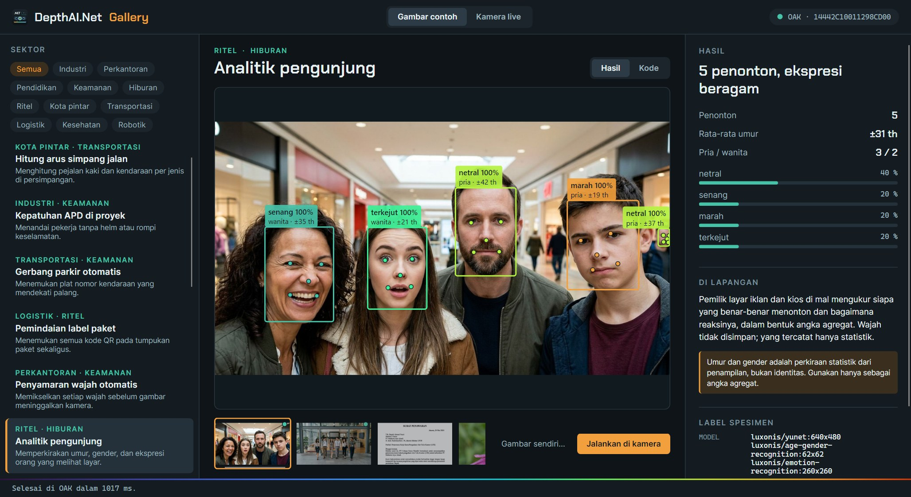

A three-model cascade in one pipeline: YuNet finds faces, then each face crop is sent back to the
camera through two more `HostInputNode`s for age/gender and emotion. Age and gender are
statistical estimates from appearance, not identity; use them as aggregates only.

### Movement and posture coach

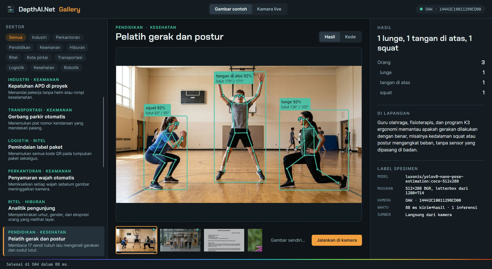

17 joints per person, then simple rules on knee angles and wrist positions recognise squats,
lunges, and arms raised overhead.

### Workspace inventory

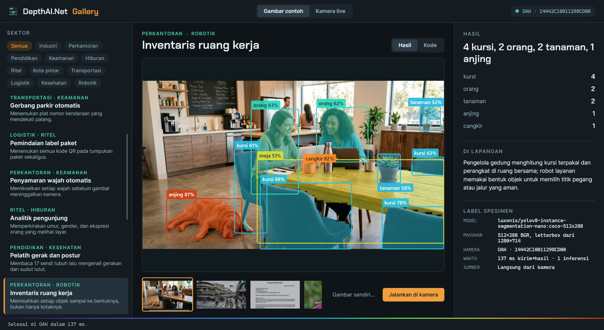

Instance segmentation gives each object its shape. Mask coefficients are multiplied with the
prototypes on the host, only for boxes that survive NMS.

### Scene understanding

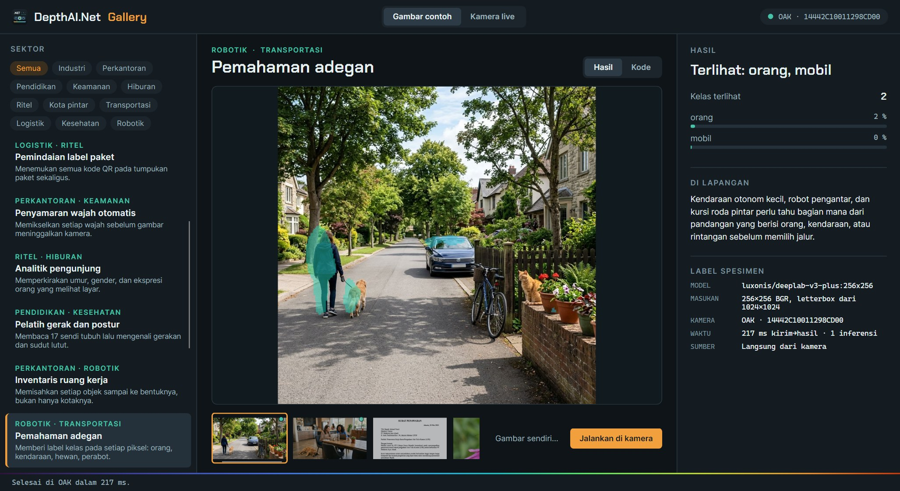

Every pixel gets a VOC class. DeepLab at 256×256 misses small objects such as the cat on the
wall; large ones (people, cars) are caught.

### Virtual meeting background

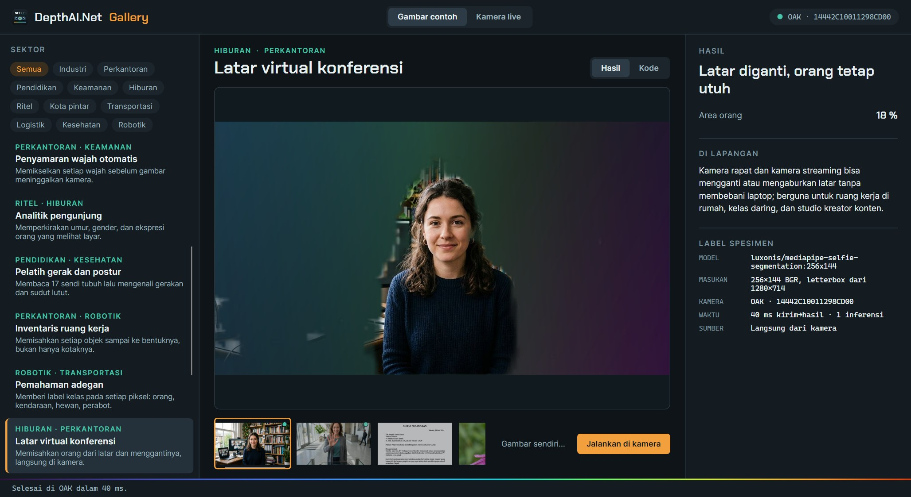

The 256×144 person mask is upscaled and softened, then the background is replaced with a Depth
Field gradient.

### Crowd density

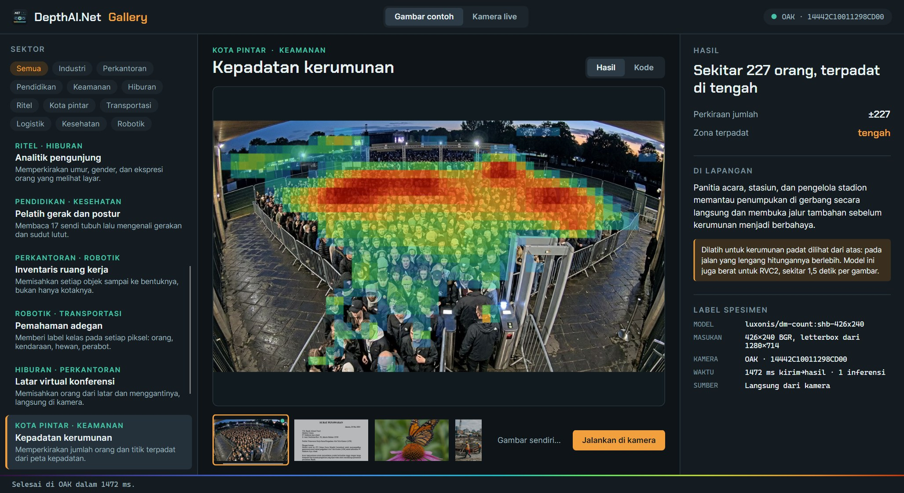

The head count is the sum of the density map. The model is trained on dense crowds seen from
above; on a quiet street it over-counts, and on RVC2 it takes about 1.5 s per image.

### Document digitisation

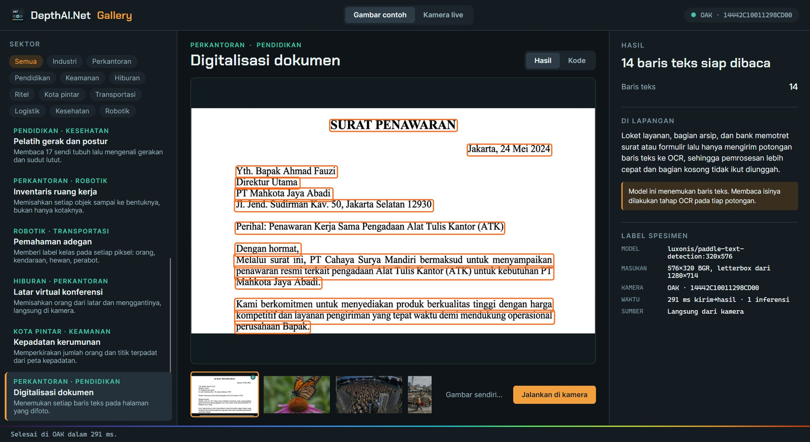

Each text line is found so that only its crop goes to OCR. The decoder uses axis-aligned boxes,
which suits straight pages; skewed pages need polygons as in PaddleOCR.

### Learn-by-pointing recognition

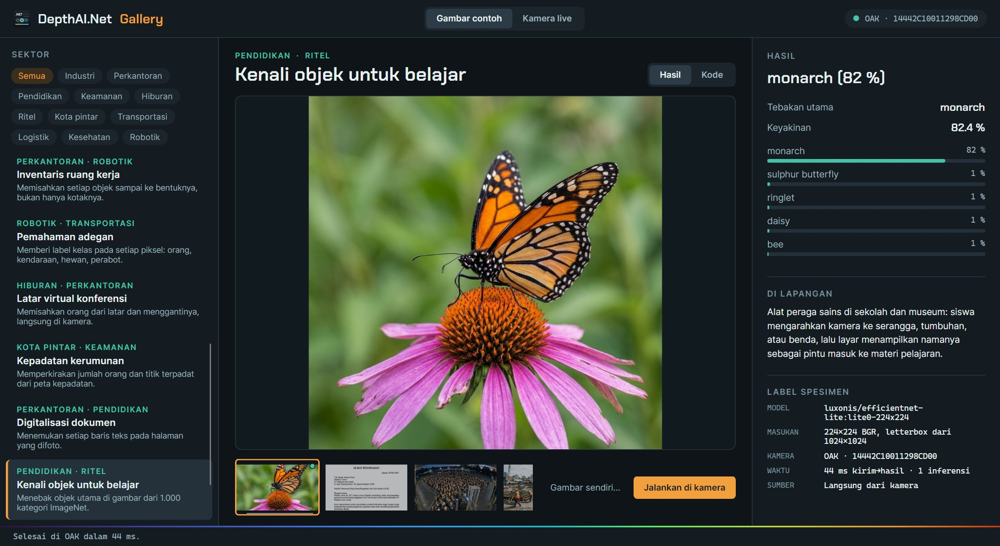

Top five guesses out of 1,000 ImageNet categories, labels kept in their original English.

### Touchless kiosk

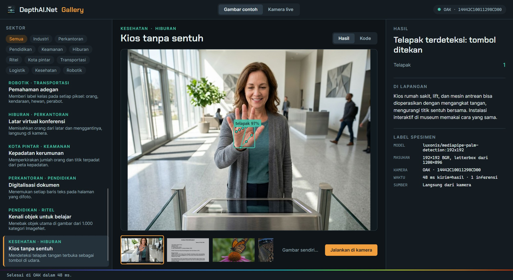

An open palm becomes a button in the air for hospital kiosks, lifts, or queue machines.

## Sample code

The **Kode** (code) tab shows a complete program for the selected use case: the image variant
uses `HostInputNode` and `InferAsync`, the live variant uses the camera and a stream
subscription. **Salin kode** copies it.

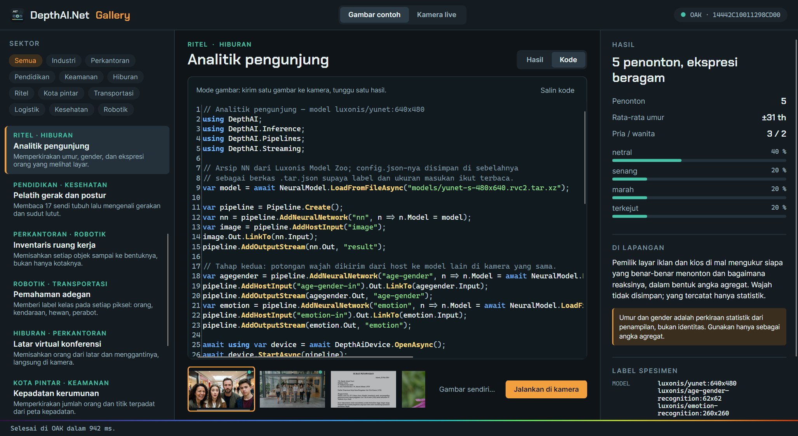

Plain YOLO models (traffic, PPE, plates, QR) and classification get a `DetectionFrame` or
`ClassificationFrame` straight from the SDK. Other models produce a `NeuralTensorFrame`; their
decoders live in `src/DepthAI.Net.Gallery/Inference/Decoders.cs` and deliberately have no UI
dependencies, so you can copy them into your own project:

| Decoder | Model | Notes |
| --- | --- | --- |
| `YoloDetections` | YOLOv6 R2, YOLOv8 (Luxonis format) | Wraps the SDK's `YoloParser` |
| `YoloGrid` | TLBR grid | Keeps the source cell for extra per-cell data |
| `PoseDecoder` | YOLOv8-pose | Keypoints already in model pixels; scores are still logits |
| `InstanceSegmentationDecoder` | YOLOv8-seg | Coefficients × prototypes on the host |
| `YuNetDecoder` | YuNet (libfacedetection) | 17610 priors for 640×480, OpenCV 4.5.4 formulas |
| `PalmDecoder` | MediaPipe palm | 2016 SSD anchors |
| `TextDetectionDecoder` | PaddleOCR DB | Connected components + unclip offset |

## Light theme

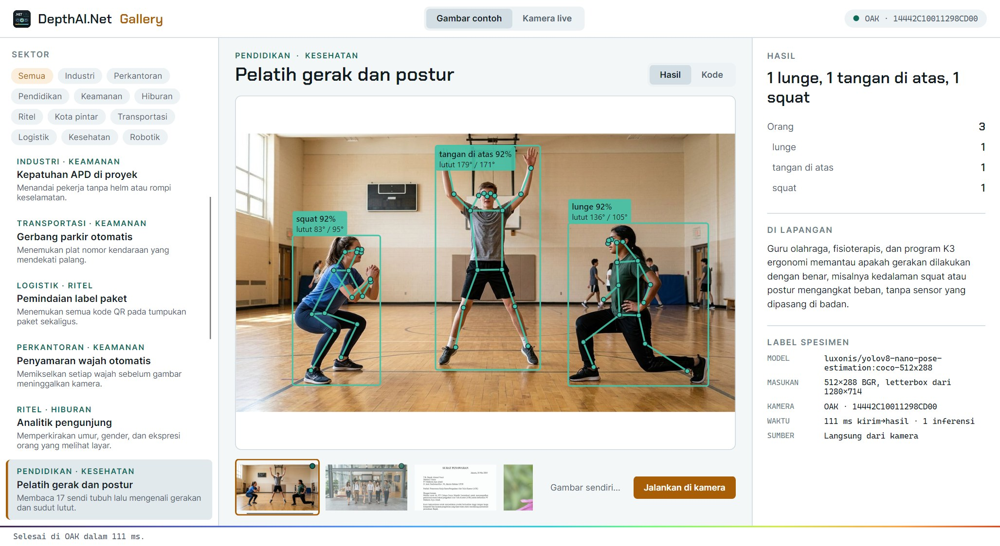

The gallery uses the same Depth Field visual system as Jack The Code Bender. Accents are sampled
from the Turbo colour map, the one the SDK uses to colour depth, and the stage's scan line is the
depth ribbon turned upright.

## Models

Model archives are not in the repo. When a use case is first opened, the gallery downloads them
from the Luxonis Model Zoo (the same endpoint as `dai::getModelFromZoo`, no API key) and caches
them in:

- Windows: `%LOCALAPPDATA%\DepthAI.Net\Gallery\models`
- Linux: `~/.local/share/DepthAI.Net/Gallery/models`

All 15 models total about 150 MB; the crowd model alone is 81 MB. .NET cannot open `.tar.xz`
without an extra library, so each model's `config.json` is copied into `ModelConfigs/` and
installed as a `.tar.json` sidecar that `NeuralModel.LoadFromFileAsync` recognises.

## Command-line options

| Option | Purpose |
| --- | --- |
| `--record [use-case]` | Runs use cases on their sample images on the camera and rewrites `Samples/recorded.json` in the repo source |
| `--live-check [use-case…]` | Tests live mode without a window; prints rates and results, saves no frames |
| `--screenshot <folder>` | Captures the window for each use case (`--shots ppe,audience:code` for a subset) |
| `--usecase <id>`, `--light` | Initial use case and light theme |

Live mode is deliberately not captured for documentation: it shows the room the camera is in.

## Verified and not verified

- All 14 use cases were run on an OAK-1 on Windows, both on images and live. The results and
  figures on this page come from there.
- Linux x64 and ARM64 have never opened a camera, this gallery included.
- The OAK-1 has no stereo pair, so the gallery has no depth use case.
- When the pipeline changes, depthai-core sometimes logs "Device crashed, but no crash dump could
  be extracted". That is the device reboot that happens every time a pipeline stops; the next
  pipeline runs normally.
