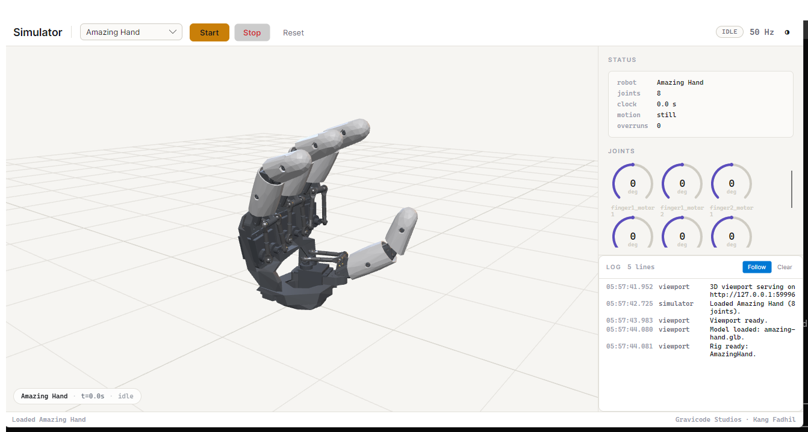

# Amazing Hand

Pollen's open-hardware hand: four fingers, eight servos, no thumb and no wrist.



*Pollen's own CAD geometry, decoded from their MuJoCo model. The parallel linkage behind each
finger is visible, which is the point: it is what makes this hand different from a gripper.*

## What it is, and what it is not

| | |
|---|---|
| Fingers | 4, all equivalent |
| Servos | 8 — two per finger, Feetech SCS0009 |
| Thumb | **None.** This surprises everyone writing grasp code for it |
| Wrist | Not part of the hand; it bolts to one |
| Sensing | None. No contact, no force, no position feedback beyond the servos |

## Two servos, one finger

Each finger is a **parallel four-bar** driven by both of its servos together. Neither motor is a
knuckle. Their **sum** curls the finger and their **difference** swings it sideways:

```csharp
// What you almost always want.
await hand.SetPoseAsync(AmazingHandPose.Uniform(FingerPose.Degrees(bend: 60)));

// One finger, splayed out.
await hand.SetFingerAsync(1, FingerPose.Degrees(bend: 30, splay: 20));
```

Commanding a motor directly is possible and is rarely what anyone means — move `finger1_motor1`
alone and the finger both curls *and* swings. `FingerPose` exists to keep that arithmetic in one
place.

The mapping is first-order. Pollen publishes the linkage geometry but no closed-form solution, and
the real mechanism is mildly non-linear toward full curl. It is good enough to drive postures and
to animate the simulator; it is not a substitute for the robot's own calibration.

## The hand is handed

`HandSide.Left` mirrors splay. The same `FingerPose` produces opposite motor signs on the two
hands, so a bimanual routine that copies angles across will splay one hand inward and the other
outward.

## There is no hardware transport

**This SDK cannot drive a physical Amazing Hand.** Pollen controls it over a Feetech serial bus
from their own Rust tool (`Demo/AHControl`) and from an Arduino sketch; they publish no network
protocol for it. Inventing one here would be a wire format with nothing to check it against — the
same mistake this project avoided for Reachy 2 by vendoring real protos, and the same class of
mistake it *made* twice on the MicroDuck's joint table.

What ships is the client, the posture model, and the simulation. `IAmazingHandTransport` is the
seam: implement it over a serial port and the rest of the SDK works unchanged.

```csharp
var model = new SimulatedAmazingHand();
await using var engine = new SimulationEngine(model);
await engine.StartAsync();

await using var hand = new AmazingHandClient(
    new SimulatedAmazingHandTransport(model, engine), ownsTransport: true);

await hand.ConnectAsync();
await hand.TurnOnAsync();                       // the servos start unpowered
await hand.GotoPoseAsync(AmazingHandPose.Fist, TimeSpan.FromSeconds(1));
```

## Safety

- **The servos start unpowered**, here and on hardware. A hand that ignores your first command is
  a hand you have not turned on.
- **There is no contact sensing.** A finger that meets an obstacle keeps pushing until the servo
  stalls, and an SCS0009 will hold that stall indefinitely — it gets hot, not sorry. Bound how long
  a grasp is held, and `RelaxAsync` when you are done.
- **The simulation will close through anything.** It is kinematic: it proves a posture is
  reachable and tells you nothing about whether a real finger would hold, slip or stall.
- `GotoPoseAsync` interpolates; `SetPoseAsync` is a step input. The servos have no on-board
  interpolation, so a step is the difference between a hand that closes and one that slams.

## Where the numbers come from

`src/PollenRobotics.Net.AmazingHand/Reference/robot.xml` is Pollen's own MuJoCo model, vendored
under Apache 2.0 from [pollen-robotics/AmazingHand](https://github.com/pollen-robotics/AmazingHand)
at commit `3e8241074df3`. The joint order is its actuator order, which also matches servo ids 1–8
in their `r_hand.toml` — the model and the wire agree here. That is worth stating because for the
MicroDuck they did not, and assuming they would cost two releases. See
[joint-models.md](joint-models.md).

The 3D model is built from the same file plus Pollen's STL assets, fetched at build time by
[`tools/blender/amazing_hand.py`](../tools/blender/amazing_hand.py). Fasteners are skipped and
shells decimated; the shapes are Pollen's, not approximations.
