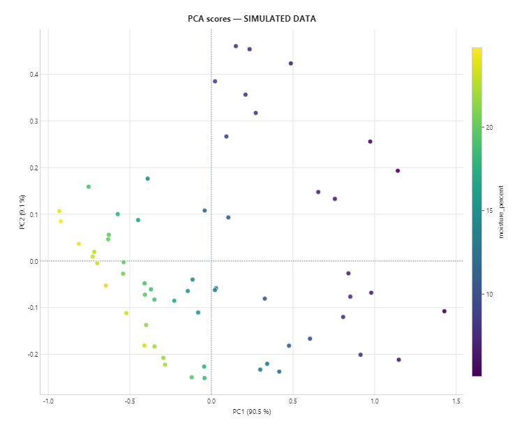
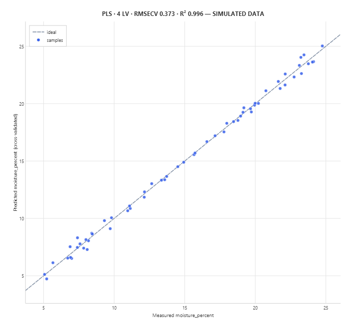
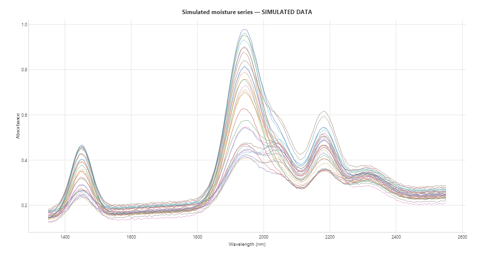

<p align="center"></p>

<h1 align="center">SiWare.NET</h1>

<p align="center">.NET 10 SDK, driver bridge, Rust DSP, and sample apps for Si-Ware spectral sensors.<br>
SDK .NET 10, jembatan driver, DSP Rust, dan aplikasi contoh untuk sensor spektral Si-Ware.</p>

<p align="center"><b>Created by Gravicode Studios, led by Kang Fadhil</b><br>
<b>Dibuat oleh Gravicode Studios dipimpin oleh Kang Fadhil</b></p>


> **Status: 0.1.0.** The SDK, simulator, processing, and apps are tested, and discovery and acquisition through the vendor bridge are **validated on a physical Si-NIR Matrix DVK over USB on Windows 10**. Measurement accuracy against a reference instrument is not yet validated ([hardware validation](docs/en/hardware-validation.md)). Simulated spectra are always marked `IsSimulated = true` and labelled *SIMULATED DATA* in every app.
>
> **Status: 0.1.0.** SDK, simulator, pemrosesan, dan aplikasi sudah diuji, dan penemuan perangkat serta akuisisi melalui jembatan vendor **sudah divalidasi pada sensor fisik Si-NIR Matrix DVK lewat USB di Windows 10**. Akurasi pengukuran dibanding instrumen acuan belum divalidasi ([validasi perangkat keras](docs/id/hardware-validation.md)). Spektrum simulasi selalu bertanda `IsSimulated = true` dan berlabel *DATA SIMULASI*.

## English

### What's inside

| Component | Path | Purpose |
|---|---|---|
| SDK | `src/SiWare.Sdk` | `Spectrum` model, `ISpectrometer` with simulator and vendor bridge, calibration and processing, JSON/CSV exchange |
| Analysis | `src/SiWare.Analysis` | Chemometrics on GravicodeScience: Savitzky-Golay, MSC, PCA, PLS with cross-validation, DataFrame export |
| Visualization | `src/SiWare.Visualization` | Headless PNG/SVG/PDF charts with Visual.Net (Matplotlib.Net) |
| AI | `src/SiWare.Ai` | Advisory interpretation via the Hugging Face router, any OpenAI-compatible API, or a local HF.Net model |
| Rust DSP | `native/siware-dsp` | Dependency-free SNV, smoothing, and absorbance kernels behind a versioned C ABI |
| Workbench | `samples/SiWare.Workbench` | Web app: connect, calibrate, capture, plot, process, history, export (EN/ID) |
| CLI | `samples/SiWare.Cli` | Scriptable acquisition, demo pipeline, PCA/PLS analysis, charts, and AI explanations |
| Vendor bridge | `scripts/vendor_bridge.py` | JSON-lines worker that hosts the proprietary `pyDriver.pyd` in CPython 3.10 |
| Tests | `tests/SiWare.Sdk.Tests`, `tests/SiWare.Analysis.Tests`, `native/siware-dsp/tests` | 114 xUnit tests, 9 Rust tests, Playwright UI smoke test |

### Quick start

Requirements: .NET SDK 10.0.100+, Rust 1.87+ (optional, for native kernels), Windows x64 for the vendor bridge.

```sh
cargo build --release --manifest-path native/siware-dsp/Cargo.toml   # required for the full test suite
dotnet build SiWare.Net.slnx
dotnet test SiWare.Net.slnx
dotnet run --project samples/SiWare.Workbench                       # http://localhost:5069
dotnet run --project samples/SiWare.Cli -- demo --output artifacts/demo
```

```csharp
await using ISpectrometer device = new SimulatedSpectrometer();
await device.ConnectAsync();
var scan = new ScanOptions(Points: 257, IntegrationMilliseconds: 100, Averages: 3);
var dark = await device.AcquireAsync(MeasurementKind.Dark, scan);
var reference = await device.AcquireAsync(MeasurementKind.Reference, scan);
var sample = await device.AcquireAsync(MeasurementKind.Sample, scan);
var absorbance = SpectralProcessing.Absorbance(sample, dark, reference);
```

### Documentation

- [Getting started](docs/en/getting-started.md): install, build, run the apps, build the NuGet package
- [Architecture](docs/en/architecture.md): components, data flow, design decisions
- [API guide](docs/en/api.md): SDK types, processing, file formats, Workbench HTTP API
- [Analysis, charts, and AI](docs/en/analysis.md): PCA, PLS calibration, preprocessing, plots, LLM interpretation
- [Vendor integration](docs/en/vendor-integration.md): connecting a real Si-Ware sensor through the vendor driver
- [Hardware validation](docs/en/hardware-validation.md): what is verified, what is not, and the release checklist
- Research evidence: [vendor API](docs/research/vendor-api.md), [driver static inspection](docs/research/driver-static.md)

## Bahasa Indonesia

### Isi repositori

| Komponen | Lokasi | Fungsi |
|---|---|---|
| SDK | `src/SiWare.Sdk` | Model `Spectrum`, `ISpectrometer` dengan simulator dan jembatan vendor, kalibrasi dan pemrosesan, ekspor/impor JSON/CSV |
| Analisis | `src/SiWare.Analysis` | Kemometrik dengan GravicodeScience: Savitzky-Golay, MSC, PCA, PLS dengan validasi silang, ekspor DataFrame |
| Visualisasi | `src/SiWare.Visualization` | Grafik PNG/SVG/PDF tanpa jendela dengan Visual.Net (Matplotlib.Net) |
| AI | `src/SiWare.Ai` | Interpretasi bersifat saran lewat router Hugging Face, API kompatibel OpenAI, atau model lokal HF.Net |
| DSP Rust | `native/siware-dsp` | Kernel SNV, penghalusan, dan absorbansi tanpa dependensi, melalui C ABI berversi |
| Workbench | `samples/SiWare.Workbench` | Aplikasi web: hubungkan, kalibrasi, rekam, grafik, proses, riwayat, ekspor (EN/ID) |
| CLI | `samples/SiWare.Cli` | Akuisisi lewat skrip, pipeline demo, analisis PCA/PLS, grafik, dan penjelasan AI |
| Jembatan vendor | `scripts/vendor_bridge.py` | Worker JSON-lines yang menjalankan `pyDriver.pyd` proprietary di CPython 3.10 |
| Pengujian | `tests/SiWare.Sdk.Tests`, `tests/SiWare.Analysis.Tests`, `native/siware-dsp/tests` | 114 tes xUnit, 9 tes Rust, smoke test UI Playwright |

### Mulai cepat

Kebutuhan: .NET SDK 10.0.100+, Rust 1.87+ (opsional, untuk kernel native), Windows x64 untuk jembatan vendor. Perintah build dan contoh kode sama seperti bagian English di atas.

### Dokumentasi

- [Memulai](docs/id/getting-started.md): instalasi, build, menjalankan aplikasi, membuat paket NuGet
- [Arsitektur](docs/id/architecture.md): komponen, alur data, keputusan desain
- [Panduan API](docs/id/api.md): tipe SDK, pemrosesan, format berkas, HTTP API Workbench
- [Analisis, grafik, dan AI](docs/id/analysis.md): PCA, kalibrasi PLS, prapemrosesan, grafik, interpretasi LLM
- [Integrasi vendor](docs/id/vendor-integration.md): menghubungkan sensor Si-Ware nyata melalui driver vendor
- [Validasi perangkat keras](docs/id/hardware-validation.md): apa yang sudah dan belum terverifikasi, serta daftar periksa rilis

## Screenshots / Tangkapan layar

| Workbench (Bahasa Indonesia) | Mobile | CLI |
|---|---|---|
|  |  |  |

| PCA scores / Skor PCA | PLS calibration / Kalibrasi PLS | Spectra / Spektrum |
|---|---|---|
|  |  |  |

## License / Lisensi

MIT. See [LICENSE](LICENSE). The Si-Ware driver and Si-Spect Platform are proprietary third-party software. They are not included, and this project is not affiliated with Si-Ware Systems.
MIT. Driver Si-Ware dan Si-Spect Platform adalah perangkat lunak pihak ketiga yang proprietary. Keduanya tidak disertakan, dan proyek ini tidak berafiliasi dengan Si-Ware Systems.

Roadmap: [PLAN.md](PLAN.md) · Progress / Progres: [Progress.md](Progress.md)
