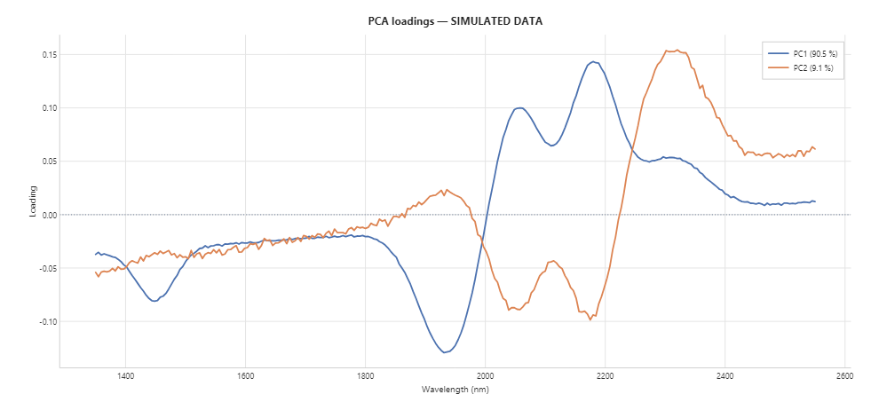
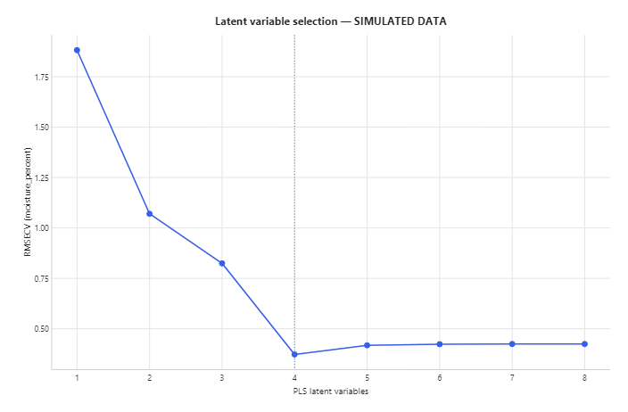
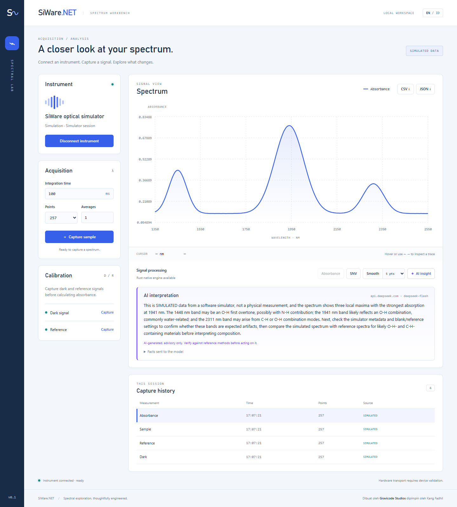

# Analysis, charts, and AI

*SiWare.NET, created by Gravicode Studios, led by Kang Fadhil.* · [Bahasa Indonesia](../id/analysis.md)

Three opt-in packages build on the core SDK. The core `Gravicode.SiWare.Sdk` has no dependency on them.

| Package | Built on | Provides |
|---|---|---|
| `Gravicode.SiWare.Analysis` | [GravicodeScience](https://github.com/DotNetVibeCoderz/Vibe_ML/tree/main/GravicodeScience) (GraviNum, GraviLearn, GraviFrame) | `SpectralDataset`, Savitzky-Golay, MSC, PCA, PLS regression, cross-validated calibration, DataFrame/CSV export, simulated labelled datasets |
| `Gravicode.SiWare.Visualization` | [Visual.Net](https://github.com/DotNetVibeCoderz/Vibe_Charting/tree/main/Visual.Net) (Matplotlib.Net) | Headless PNG/SVG/PDF charts: spectrum overlays, PCA scores and loadings, predicted vs measured, RMSECV |
| `Gravicode.SiWare.Ai` | [HF.Net](https://github.com/DotNetVibeCoderz/Vibe_ML/tree/main/HF.Net) (GraviTransformers) + any OpenAI-compatible API | Advisory natural-language interpretation of spectra and models |

Every chart and AI prompt carries the data's provenance. Simulated data is titled *SIMULATED DATA*, and the model is told so.

## Datasets

`SpectralDataset` holds spectra on one wavelength grid, with optional reference values (laboratory results). It refuses to mix grids, measurement kinds, provenance, or acquisition settings, matching the calibration rules of the core SDK.

```csharp
using SiWare.Analysis;

var dataset = new SpectralDataset(spectra, referenceValues: moisture, referenceName: "moisture_percent");
NdArray x = dataset.ToMatrix();          // samples × wavelengths (GraviNum)
NdArray y = dataset.ToTarget();
dataset.ToDataFrame().WriteCsv("dataset.csv");                 // GraviFrame, pandas-style wide table
File.WriteAllText("dataset.json", SpectralDatasetFile.ToJson(dataset));   // keeps provenance and settings

var demo = SimulatedSampleSet.Generate(samples: 60, points: 257);  // known moisture, IsSimulated = true
```


## Preprocessing

| Method | Call | Notes |
|---|---|---|
| Savitzky-Golay smoothing | `Preprocessing.SavitzkyGolay(s, window: 11, polynomialOrder: 2)` | Polynomial edge fitting, like SciPy `mode="interp"`; keeps the length |
| Savitzky-Golay derivative | `Preprocessing.SavitzkyGolay(s, 15, 2, derivative: 1)` | Per nm; requires an evenly spaced grid (within 1%) |
| MSC | `Preprocessing.MultiplicativeScatterCorrection(dataset)` | Regresses each spectrum on the mean (or a given reference) and removes offset and slope |
| SNV, moving average | `SpectralProcessing` / `NativeDsp` in the core SDK | |

Choose preprocessing by cross-validated error, not by habit. On the simulated moisture set, MSC removes part of the moisture signal: RMSECV rises from 0.37 to 1.54.

## PCA

```csharp
var pca = PcaResult.Fit(dataset, components: 3);   // GraviLearn PCA (SVD), mean-centred
pca.ExplainedVarianceRatio;  // e.g. [0.905, 0.091, 0.0002]
pca.Scores;                  // per sample
pca.Loadings;                // per wavelength
```

| Scores coloured by moisture | Loadings |
|---|---|
|  |  |

## PLS calibration

GravicodeScience has no PLS, so `PlsRegression` implements PLS1 (NIPALS). It implements GraviLearn's `IEstimator`, so it also works with `Selection.CrossValidate` and pipelines.

```csharp
var calibration = CalibrationResult.Fit(dataset, maxComponents: 8, folds: 5);
// Tries 1..8 latent variables with K-fold CV, keeps the lowest RMSECV, refits on all samples.
Console.WriteLine($"{calibration.Components} LV, RMSECV {calibration.RmseCv:G3}, R² {calibration.R2Cv:F3}");

var model = new PlsRegression(4);
model.Fit(dataset.ToMatrix(), dataset.ToTarget());
NdArray predicted = model.Predict(newSpectraMatrix);
```

| Cross-validated predictions | Latent variable selection |
|---|---|
|  |  |

## Charts

```csharp
using SiWare.Visualization;

SpectrumCharts.Overlay(dataset.Spectra, "Moisture series").Save("overlay.png");  // .svg, .pdf, .jpg also work
SpectrumCharts.PcaScores(pca, colorValues: dataset.ReferenceValues, colorLabel: "moisture").Save("scores.svg");
SpectrumCharts.PredictedVsMeasured(calibration).Save("pls.pdf");
byte[] png = SpectrumCharts.PcaLoadings(pca).ToPng();   // for web responses
```

Rendering uses SkiaSharp and needs no window or display.

## AI interpretation

The model never sees raw data. `SpectrumFacts` computes a short, deterministic summary: provenance, range, band positions with prominence, PCA variance, and PLS metrics. Only that summary is sent, so every statement can be checked against a computed number. The prompt forbids inventing values, requires hedged band assignments, and makes the model mention simulated data first. Every `Interpretation` carries `IsAiGenerated = true` and a disclaimer.

```csharp
using SiWare.Ai;

string facts = SpectrumFacts.Describe(absorbance);      // or Describe(pca), Describe(calibration)

// Hugging Face Inference Providers router (token from HF_TOKEN)
using var http = new HttpClient();
var remote = new ChatCompletionsInterpreter(http, ChatCompletionsOptions.HuggingFaceRouter("meta-llama/Llama-3.1-8B-Instruct"));
Interpretation answer = await remote.InterpretAsync(facts, language: "id");

// Any OpenAI-compatible endpoint (Azure OpenAI v1, DeepSeek, a local server)
var other = new ChatCompletionsInterpreter(http, new(new Uri("https://api.example.com/v1"), "model-id", apiKeyFromSecretStore));

// Fully local with HF.Net: downloads once from the Hub, then runs on this machine
using var local = await LocalModelInterpreter.LoadAsync("Qwen/Qwen2.5-0.5B-Instruct");
var offline = await local.InterpretAsync(facts);
```

| Provider | When to use | Notes |
|---|---|---|
| `HuggingFaceRouter` | Best quality with an HF account | Needs Inference Providers credit. An empty account returns HTTP 402, reported as `HttpRequestException` |
| OpenAI-compatible | You already have another provider | The key goes in `ChatCompletionsOptions.ApiKey`; `ToString()` never prints it |
| `LocalModelInterpreter` | Offline, private, or no credits | Managed CPU inference: slow, so keep models around 0.5B parameters. Supports Qwen2/2.5/3, Llama, Mistral, GPT-2, and GPT-NeoX families |

## Workbench

The Workbench shows an **AI insight** button in the processing bar when the server is started with an LLM configured. Keys stay on the server; the browser never sees them.

```powershell
$env:HF_TOKEN = "<token>"                                   # Hugging Face router; optional SIWARE_LLM_MODEL
# or any OpenAI-compatible provider:
$env:SIWARE_LLM_BASE_URL = "https://api.deepseek.com"; $env:SIWARE_LLM_MODEL = "deepseek-v4-flash"; $env:SIWARE_LLM_API_KEY = "<key>"
dotnet run --project samples/SiWare.Workbench
```

Without either setting, the button stays disabled and its tooltip says how to enable it. The answer appears under the chart with the provider, the model, the disclaimer, and an expandable list of the facts that were sent. Selecting another spectrum clears a stale answer.



## Tested providers

Results from 2026-10-20 with the simulated absorbance spectrum:

| Provider | Result |
|---|---|
| DeepSeek `deepseek-v4-flash` (OpenAI-compatible) | Correct, hedged band assignments in English and Indonesian; states that the data is simulated. A reasoning model: it needs the default 1200-token budget, because 400 tokens produced an empty answer. |
| Hugging Face router | Request path verified; the test account had no Inference Providers credit (HTTP 402, reported clearly). |
| Local `Qwen/Qwen2.5-0.5B-Instruct` via HF.Net | Runs fully offline (about 6.5 min on first run, including the ~1 GB download), but a 0.5B model ignores formatting instructions and lists generic bonds. Use it for offline plumbing, not for quality answers. |

## CLI

```sh
siware dataset --samples 60 --output artifacts/dataset
siware analyze --input artifacts/dataset/dataset.json --components 3 --output artifacts/analysis
siware calibrate --input artifacts/dataset/dataset.json --max-components 8 --folds 5 --output artifacts/calibration
siware calibrate --input dataset.json --msc --derivative 1 --sg-window 15      # compare preprocessing
siware plot --input dark.json,reference.json,sample.json --output plot.svg
siware explain --input artifacts/demo/absorbance.json --language id                       # HF router, HF_TOKEN
siware explain --input dataset.json --analysis pls --provider local                       # HF.Net on CPU
siware explain --input sample.json --provider openai --base-url https://api.example.com/v1 --model model-id   # SIWARE_LLM_API_KEY
```

`siware` stands for `dotnet run --project samples/SiWare.Cli --`. Before calling a model, `explain` prints exactly which facts it sends.

## Tests

`tests/SiWare.Analysis.Tests` (24 tests) checks:

- Savitzky-Golay coefficients against published tables, exactness on quadratics including the edges
- MSC recovery, dataset validation, and JSON round trips
- PCA variance ordering, PLS exact recovery and GravicodeScience cross-validation, calibration accuracy
- Chart rendering and simulated labels
- Fact extraction (finds the simulator's 1450/1940/2310 nm bands, invariant culture)
- The chat-completions request, error handling, and key hygiene, all through a fake HTTP handler

The live LLM test is opt-in: `SIWARE_LIVE_LLM=1` plus `HF_TOKEN`.
