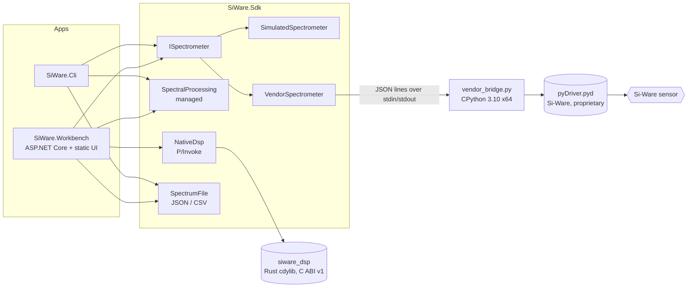

# Architecture

*SiWare.NET, created by Gravicode Studios, led by Kang Fadhil.* · [Bahasa Indonesia](../id/architecture.md)

## Overview



The SDK keeps three concerns separate:

| Concern | Types | Notes |
|---|---|---|
| **Transport / device** | `ISpectrometer`, `SimulatedSpectrometer`, `VendorSpectrometer`, `ScanOptions`, `DeviceInfo` | Owns the connection, serializes operations, supports cancellation |
| **Data model** | `Spectrum`, `MeasurementKind`, `SpectrumFile` | Immutable, validated on construction, carries provenance |
| **Processing** | `SpectralProcessing`, `NativeDsp` | Pure functions from spectra to new spectra |

## Data model

`Spectrum` is an immutable snapshot: `Id`, `DeviceId`, `CapturedAt`, `Kind`, `IsSimulated`, `Wavelengths` (nanometres), and `Values`. The constructor rejects anything inconsistent:

- 2 to 1,000,000 points, with wavelengths and values of matching length
- all values finite, and wavelengths positive and strictly ascending

Because every `Spectrum` is valid by construction, processing code never re-checks shape. Input arrays are copied, so callers cannot mutate a spectrum afterwards. Processing returns a **new** spectrum (`WithValues`) that keeps the source's device and provenance.

`MeasurementKind` distinguishes raw acquisitions (`Sample`, `Dark`, `Reference`) from derived results (`Absorbance`, `Normalized`). Devices only produce raw kinds.

**Provenance is never lost.** `IsSimulated` is set by the device and copied by every processing step. Calibration (`SpectralProcessing.Match`) refuses to combine spectra from different devices or provenance, or on different wavelength grids. CSV has no provenance column, so `SpectrumFile.FromCsv` requires the caller to state the device ID and simulation flag explicitly.

## Devices

`ISpectrometer` implementations guard each operation with a `SemaphoreSlim`, so a device can be shared safely, though operations run one at a time. All methods accept a `CancellationToken`.

- **`SimulatedSpectrometer`**: a deterministic (seeded) synthetic NIR signal over 1350–2550 nm, with a lamp profile, three absorption bands at 1450, 1940, and 2310 nm, and small noise. It honours integration time (as a delay) and averaging. It is a development aid, **not** a hardware emulator.
- **`VendorSpectrometer`**: adapts the installed Si-Ware Python binding. See [Vendor integration](vendor-integration.md).

### Why a Python worker process?

Static and import-time inspection of the Si-Spect Platform (see `docs/research/`) showed that the vendor driver is a **CPython 3.10 native extension** (`pyDriver.cp310-win_amd64.pyd`), not a .NET assembly or a documented C SDK. Its wire protocol and packet layouts are not public, so reimplementing them would mean guessing. The SDK therefore calls the real vendor binding, hosted in a separate process:

- **Isolation**: a crash or hang in native vendor code cannot take down the .NET process. On timeout or error, the worker process tree is killed.
- **Bounded IPC**: one JSON object per line, with request IDs correlated, a 1 MiB line limit, and a configurable timeout (30–600 s).
- **Clean stdout**: the worker redirects vendor diagnostics to stderr, which .NET drains and discards (vendor logs may contain local configuration).
- **No guessing**: scan-time units, the mode value, and the wavenumber axis unit must be confirmed by the user in configuration.

## Processing

| Operation | Managed | Native (Rust) | Notes |
|---|---|---|---|
| Absorbance | `SpectralProcessing.Absorbance` | `NativeDsp.Absorbance` | `-log10((S-D)/(R-D))`, computed as `log10(R-D) - log10(S-D)` to avoid ratio overflow. Requires positive corrected signals |
| SNV | `SpectralProcessing.StandardNormalVariate` | `NativeDsp.StandardNormalVariate` | Sample standard deviation (N-1). Rejects constant spectra. Pre-scales by max-abs for numerical range |
| Moving average | `SpectralProcessing.Smooth` | `NativeDsp.Smooth` | Odd window; edge windows truncated; O(N) sliding sum |

`NativeDsp` methods **never silently fall back** to managed code. If the library is missing or the ABI version differs, they throw `PlatformNotSupportedException`. Callers choose explicitly with `NativeDsp.IsAvailable`, as the Workbench does.

### Rust ABI

`native/siware-dsp` is a dependency-free `cdylib` that exports `siware_dsp_abi_version` (currently `1`), `siware_dsp_snv`, `siware_dsp_smooth`, and `siware_dsp_absorbance`. The C declarations live in `include/siware_dsp.h`. The contract:

- Status codes: `0` success, `1` invalid argument, `2` non-finite or domain error
- Output is written only on success (computed into a temporary first), and must not overlap the inputs
- Null, misaligned, overlapping, or overflowing buffers are rejected, and panics are caught at the boundary
- No ownership crosses the ABI, because the caller allocates all buffers

When changing the ABI, update the Rust exports, the header, and the `DllImport` declarations together, and bump the version.

## Workbench

`SiWare.Workbench` is an ASP.NET Core minimal API that serves a dependency-free static UI (`wwwroot/`, vanilla JS + SVG chart).

- **`WorkbenchSession`** (singleton) owns the `ISpectrometer`, the current dark/reference calibration, and a bounded history of 100 spectra. One acquisition runs at a time; extra requests get `409`.
- **Device selection**: the simulator, or `VendorSpectrometer` when `SIWARE_VENDOR_CONFIG` points to a configuration file.
- **Hardening**: cross-origin POSTs are rejected (`403`), request bodies are capped at 64 KiB, a strict `Content-Security-Policy` disallows inline scripts and styles, and `X-Content-Type-Options: nosniff` is set.
- **Error mapping**: `KeyNotFoundException` → 404, `InvalidOperationException` / cancellation → 409, `IOException` (device or worker failure) → 502, and validation errors → 400. Cancellation deliberately avoids `408`: browsers transparently resend requests answered with 408, which would rerun a cancelled acquisition.
- **UI**: bilingual (EN/ID), keyboard-accessible chart cursor, responsive down to 390 px, and a permanent *SIMULATED DATA* / *HARDWARE · UNVERIFIED* badge.

## Repository layout

```
src/SiWare.Sdk/            SDK library (NuGet: Gravicode.SiWare.Sdk)
native/siware-dsp/         Rust DSP crate, C header, Rust tests
samples/SiWare.Workbench/  Web workbench
samples/SiWare.Cli/        Command-line sample
tests/SiWare.Sdk.Tests/    xUnit tests (no hardware required)
scripts/                   Vendor bridge and probe, UI smoke test, icon and screenshot renderers
docs/                      en/, id/, research/, screenshots/, assets/, nuget/
```

Shared build settings live in `Directory.Build.props` (net10.0, nullable, warnings as errors). `Directory.Build.targets` copies the native library into every project's output when it has been built.
