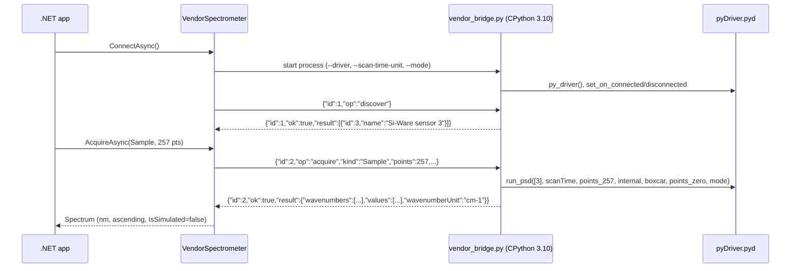

# Vendor integration

*SiWare.NET, created by Gravicode Studios, led by Kang Fadhil.* · [Bahasa Indonesia](../id/vendor-integration.md)

> The bridge calls the **real** installed Si-Ware driver, but it has not yet been validated against a physical sensor. Treat readings as unverified until the checklist in [Hardware validation](hardware-validation.md) is complete. The Workbench labels such sessions *HARDWARE · UNVERIFIED*.

## How it works



Discovery waits up to 5 seconds for the driver's connection callback. `Sample` uses `run_psd`. `Reference` uses `run_background` followed by `read_background`. Repeated scans are averaged only when their wavenumber axes are identical. Wavenumbers in cm⁻¹ are converted to nanometres (`10^7 / ν`) and sorted ascending.

The adapter selects internal optical gain, boxcar apodization, and no zero padding. These are explicit choices, not vendor defaults. Dark acquisition is **not** supported because no dark operation was identified in the binding. As a result, the Workbench disables Dark capture and therefore Absorbance in vendor sessions.

## Prerequisites

1. **Si-Spect Platform** installed by Si-Ware, providing `C:\Program Files (x86)\Si-Spect Platform\Analyze\pyDriver.pyd`. It is not redistributed here.
2. **CPython 3.10 x64**. The official *embeddable* package works (`python-3.10.11-embed-amd64.zip` from python.org). Extract it to a folder of your choice.
3. **A Windows x64 .NET process.** The bridge refuses other platforms and 32-bit processes.
4. The sensor connected and powered, with the vendor's USB or network drivers installed. Confirm first that the Si-Spect application can see it.

Check the binding without touching the device:

```powershell
<python310>\python.exe scripts\vendor_bridge.py --self-test   # protocol only, imports no vendor code
<python310>\python.exe scripts\vendor_probe.py --inspect      # imports pyDriver, reads metadata, creates no driver
```

## Configuration

Copy `scripts/vendor-config.example.json` and fill in **absolute** paths:

```json
{
  "pythonExecutable": "C:\\tools\\python310\\python.exe",
  "workerScript": "C:\\src\\SiWare.Net\\scripts\\vendor_bridge.py",
  "driverModule": "C:\\Program Files (x86)\\Si-Spect Platform\\Analyze\\pyDriver.pyd",
  "scanTimeUnit": "milliseconds",
  "mode": 0,
  "confirmWavenumbersInInverseCentimeters": true,
  "deviceId": null,
  "timeoutSeconds": 60
}
```

| Field | Meaning |
|---|---|
| `scanTimeUnit` | `milliseconds` or `seconds`: the unit the driver expects for `scan_time`. The binding does not document it, so **confirm it with Si-Ware documentation**. The example file deliberately contains an invalid placeholder. |
| `mode` | Integer passed to every `run_*` call. Its meaning is undocumented; confirm it with Si-Ware. |
| `confirmWavenumbersInInverseCentimeters` | Must be `true`. It confirms that `wvn` is in cm⁻¹ before conversion to nm. |
| `deviceId` | Optional discovered device ID. When `null`, the first discovered device is used. |
| `timeoutSeconds` | 6–600. Per-request timeout. On timeout the worker is killed. |

With the NuGet package, `vendor_bridge.py` is copied to `<output>/SiWare/vendor_bridge.py`. Point `workerScript` there.

## Use it

```csharp
var options = JsonSerializer.Deserialize<VendorBridgeOptions>(File.ReadAllText("vendor.json"), SpectrumFile.JsonOptions)!;
await using var device = new VendorSpectrometer(options);
await device.ConnectAsync();
var reference = await device.AcquireAsync(MeasurementKind.Reference, new ScanOptions(Points: 257));
var sample = await device.AcquireAsync(MeasurementKind.Sample, new ScanOptions(Points: 257));
```

```powershell
$env:SIWARE_VENDOR_CONFIG = "C:\path\vendor.json"; dotnet run --project samples/SiWare.Workbench
dotnet run --project samples/SiWare.Cli -- discover --vendor-config C:\path\vendor.json
dotnet run --project samples/SiWare.Cli -- scan --vendor-config C:\path\vendor.json --output sample.json
```

## Failure behaviour

- **Any** failed, cancelled, or timed-out request kills the worker process tree and disconnects. Call `ConnectAsync` again. Native vendor calls cannot be interrupted safely any other way.
- Responses are checked for request ID, device ID, axis unit, point count, and finite values before a `Spectrum` is built.
- Non-zero vendor `Error` codes are surfaced as `IOException("Vendor operation failed with error code N")`.
- Worker stderr (vendor diagnostics) is drained and discarded. To debug, run `vendor_bridge.py` by hand and type JSON requests into it.
