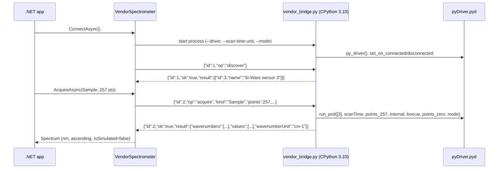

# Vendor integration

*SiWare.NET, created by Gravicode Studios, led by Kang Fadhil.* · [Bahasa Indonesia](../id/vendor-integration.md)

> The bridge calls the **real** installed Si-Ware driver. Discovery and acquisition are validated on a Si-NIR Matrix DVK over USB on Windows 10; measurement accuracy and the meaning of `mode` are still open (see [Hardware validation](hardware-validation.md)). The Workbench labels hardware sessions *HARDWARE · UNVERIFIED* until your own accuracy check is done.

## How it works



Discovery waits up to 20 seconds for the driver's connection callback and returns as soon as a sensor announces itself. A USB sensor typically takes about 6 seconds. `Sample` uses `run_psd`. `Reference` uses `run_background` followed by `read_background`. Repeated scans are averaged only when their wavenumber axes are identical. Wavenumbers in cm⁻¹ are converted to nanometres (`10^7 / ν`) and sorted ascending.

The adapter selects internal optical gain, boxcar apodization, and no zero padding. These are explicit choices, not vendor defaults. The binding has **no dark operation** (confirmed by Ghidra analysis, see [driver-ghidra.md](../research/driver-ghidra.md)). Si-Ware sensors are Fourier-transform instruments, so their spectra carry no dark offset. Vendor sessions therefore compute absorbance from the reference only with `SpectralProcessing.Absorbance(sample, reference)`, and the Workbench hides the dark step for them.

## Prerequisites

1. **Si-Spect Platform** installed by Si-Ware, providing `C:\Program Files (x86)\Si-Spect Platform\Analyze\pyDriver.pyd`. It is not redistributed here.
2. **CPython 3.10 x64**. The official *embeddable* package works (`python-3.10.11-embed-amd64.zip` from python.org). Extract it to a folder of your choice.
3. **A Windows x64 .NET process.** The bridge refuses other platforms and 32-bit processes.
4. The sensor connected and powered, with the vendor's USB or network drivers installed. Confirm first that the Si-Spect application can see it.

Check the binding without touching the device:

```powershell
<python310>\python.exe scripts\vendor_bridge.py --self-test   # protocol only, imports no vendor code
<python310>\python.exe scripts\vendor_probe.py --inspect      # imports pyDriver, reads metadata, creates no driver
```

## Configuration

Copy `scripts/vendor-config.example.json` and fill in **absolute** paths:

```json
{
  "pythonExecutable": "C:\\tools\\python310\\python.exe",
  "workerScript": "C:\\src\\SiWare.Net\\scripts\\vendor_bridge.py",
  "driverModule": "C:\\Program Files (x86)\\Si-Spect Platform\\Analyze\\pyDriver.pyd",
  "scanTimeUnit": "seconds",
  "mode": 0,
  "confirmWavenumbersInInverseCentimeters": true,
  "deviceId": null,
  "timeoutSeconds": 60
}
```

| Field | Meaning |
|---|---|
| `scanTimeUnit` | Use `seconds`. The vendor app labels `scan_time` in seconds, and all of its sample scans use 2 s (evidence in [driver-ghidra.md](../research/driver-ghidra.md)). The setting stays explicit until it is verified on a physical sensor. With seconds, `ScanOptions.IntegrationMilliseconds = 2000` matches the vendor's typical 2 s scan. |
| `mode` | Integer passed to every `run_*` call. Its meaning is still **unknown**: static analysis links it to the driver's "default" and "compatibility" request formats, but not to concrete values. Confirm it with Si-Ware; `0` is unverified. |
| `confirmWavenumbersInInverseCentimeters` | Must be `true`. It confirms that `wvn` is in cm⁻¹ before conversion to nm. |
| `deviceId` | Optional discovered device ID. When `null`, the first discovered device is used. |
| `timeoutSeconds` | 30–600. Per-request timeout; discovery alone can take up to 20 s. On timeout the worker is killed. |

With the NuGet package, `vendor_bridge.py` is copied to `<output>/SiWare/vendor_bridge.py`. Point `workerScript` there.

## Connecting the sensor

The driver talks TCP/IP: it discovers sensors by UDP broadcast on every network interface, then opens TCP connections. USB sensors appear as network adapters:

- **Si-NIR (USB RNDIS, VID 2D15 / PID F317):** install `driver\x64\Si-NIR.inf` from the Si-Spect folder. Its `install.bat` sets the host adapter to the static address `192.168.137.1/24`.
- **P10 / ESP-based (USB NCM, VID 303A / PID 4000):** install `driver\p10_x64\siwarenirusbdriver.inf`.
- Wi-Fi-connected sensors only need to be on a reachable network. Allow UDP broadcast and the driver's TCP traffic through the Windows firewall.

The vendor binding also exposes calibration-writing operations (`burn_wln`, `burn_gain`, `burn_self`, `write_*`, `restore_default_correction`). **The bridge never calls them**; it only uses discovery, `run_psd`, `run_background`, and `read_background`.

## Use it

```csharp
var options = JsonSerializer.Deserialize<VendorBridgeOptions>(File.ReadAllText("vendor.json"), SpectrumFile.JsonOptions)!;
await using var device = new VendorSpectrometer(options);
await device.ConnectAsync();
var reference = await device.AcquireAsync(MeasurementKind.Reference, new ScanOptions(Points: 257));
var sample = await device.AcquireAsync(MeasurementKind.Sample, new ScanOptions(Points: 257));
```

```powershell
$env:SIWARE_VENDOR_CONFIG = "C:\path\vendor.json"; dotnet run --project samples/SiWare.Workbench
dotnet run --project samples/SiWare.Cli -- discover --vendor-config C:\path\vendor.json
dotnet run --project samples/SiWare.Cli -- scan --vendor-config C:\path\vendor.json --output sample.json
```

## Failure behaviour

- **Any** failed, cancelled, or timed-out request kills the worker process tree and disconnects. Call `ConnectAsync` again. Native vendor calls cannot be interrupted safely any other way.
- Responses are checked for request ID, device ID, axis unit, point count, and finite values before a `Spectrum` is built.
- Non-zero vendor `Error` codes are surfaced as `IOException("Vendor operation failed with error code N")`.
- Worker stderr (vendor diagnostics) is drained and discarded. To debug, run `vendor_bridge.py` by hand and type JSON requests into it.
