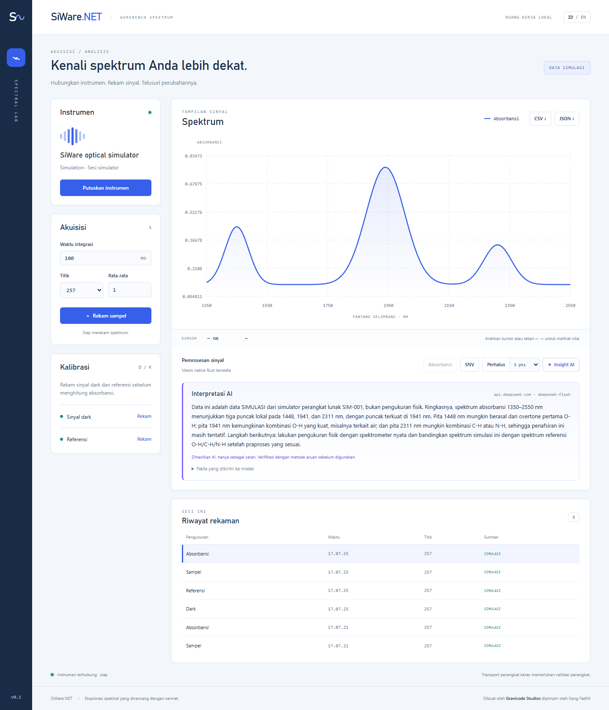

# Analisis, grafik, dan AI

*SiWare.NET, dibuat oleh Gravicode Studios dipimpin oleh Kang Fadhil.* · [English](../en/analysis.md)

Tiga paket opsional dibangun di atas SDK inti. `Gravicode.SiWare.Sdk` sendiri tidak bergantung pada paket-paket ini.

| Paket | Dibangun di atas | Isi |
|---|---|---|
| `Gravicode.SiWare.Analysis` | [GravicodeScience](https://github.com/DotNetVibeCoderz/Vibe_ML/tree/main/GravicodeScience) (GraviNum, GraviLearn, GraviFrame) | `SpectralDataset`, Savitzky-Golay, MSC, PCA, regresi PLS, kalibrasi dengan validasi silang, ekspor DataFrame/CSV, dataset simulasi berlabel |
| `Gravicode.SiWare.Visualization` | [Visual.Net](https://github.com/DotNetVibeCoderz/Vibe_Charting/tree/main/Visual.Net) (Matplotlib.Net) | Grafik PNG/SVG/PDF tanpa jendela: tumpukan spektrum, skor dan loading PCA, prediksi vs terukur, RMSECV |
| `Gravicode.SiWare.Ai` | [HF.Net](https://github.com/DotNetVibeCoderz/Vibe_ML/tree/main/HF.Net) (GraviTransformers) + API apa pun yang kompatibel dengan OpenAI | Interpretasi bahasa alami untuk spektrum dan model, bersifat saran |

Setiap grafik dan prompt AI membawa asal-usul data. Data simulasi diberi judul *SIMULATED DATA*, dan model juga diberi tahu hal itu.

## Dataset

`SpectralDataset` menampung spektrum pada satu grid panjang gelombang, beserta nilai acuan opsional (hasil laboratorium). Dataset menolak campuran grid, jenis pengukuran, provenance, atau pengaturan akuisisi, sesuai aturan kalibrasi di SDK inti.

```csharp
using SiWare.Analysis;

var dataset = new SpectralDataset(spectra, referenceValues: kadarAir, referenceName: "moisture_percent");
NdArray x = dataset.ToMatrix();          // sampel × panjang gelombang (GraviNum)
NdArray y = dataset.ToTarget();
dataset.ToDataFrame().WriteCsv("dataset.csv");                 // GraviFrame, tabel lebar ala pandas
File.WriteAllText("dataset.json", SpectralDatasetFile.ToJson(dataset));   // menyimpan provenance dan pengaturan

var demo = SimulatedSampleSet.Generate(samples: 60, points: 257);  // kadar air diketahui, IsSimulated = true
```


## Prapemrosesan

| Metode | Pemanggilan | Catatan |
|---|---|---|
| Penghalusan Savitzky-Golay | `Preprocessing.SavitzkyGolay(s, window: 11, polynomialOrder: 2)` | Tepi dihitung dengan fitting polinomial seperti SciPy `mode="interp"`; panjang data tetap |
| Turunan Savitzky-Golay | `Preprocessing.SavitzkyGolay(s, 15, 2, derivative: 1)` | Per nm; grid harus berjarak sama (toleransi 1%) |
| MSC | `Preprocessing.MultiplicativeScatterCorrection(dataset)` | Meregresikan tiap spektrum terhadap rata-rata (atau acuan yang diberikan), lalu menghapus offset dan kemiringannya |
| SNV, rata-rata bergerak | `SpectralProcessing` / `NativeDsp` di SDK inti | |

Pilih prapemrosesan berdasarkan galat validasi silang, bukan kebiasaan. Pada dataset kadar air simulasi, MSC menghapus sebagian sinyal kadar air: RMSECV naik dari 0,37 menjadi 1,54.

## PCA

```csharp
var pca = PcaResult.Fit(dataset, components: 3);   // PCA GraviLearn (SVD), dipusatkan pada rata-rata
pca.ExplainedVarianceRatio;  // mis. [0.905, 0.091, 0.0002]
pca.Scores;                  // per sampel
pca.Loadings;                // per panjang gelombang
```

| Skor diwarnai kadar air | Loading |
|---|---|
|  |  |

## Kalibrasi PLS

GravicodeScience belum menyediakan PLS, jadi `PlsRegression` mengimplementasikan PLS1 (NIPALS). Kelas ini mengimplementasikan `IEstimator` dari GraviLearn, sehingga juga bisa dipakai dengan `Selection.CrossValidate` dan pipeline.

```csharp
var calibration = CalibrationResult.Fit(dataset, maxComponents: 8, folds: 5);
// Mencoba 1..8 variabel laten dengan validasi silang K-fold, memilih RMSECV terendah, lalu melatih ulang dengan semua sampel.
Console.WriteLine($"{calibration.Components} LV, RMSECV {calibration.RmseCv:G3}, R² {calibration.R2Cv:F3}");
```

| Prediksi validasi silang | Pemilihan variabel laten |
|---|---|
|  |  |

## Grafik

```csharp
using SiWare.Visualization;

SpectrumCharts.Overlay(dataset.Spectra, "Seri kadar air").Save("overlay.png");  // .svg, .pdf, .jpg juga bisa
SpectrumCharts.PcaScores(pca, colorValues: dataset.ReferenceValues, colorLabel: "kadar air").Save("skor.svg");
SpectrumCharts.PredictedVsMeasured(calibration).Save("pls.pdf");
byte[] png = SpectrumCharts.PcaLoadings(pca).ToPng();   // untuk respons web
```

Rendering memakai SkiaSharp dan tidak memerlukan jendela atau layar.

## Interpretasi AI

Model tidak pernah menerima data mentah. `SpectrumFacts` menghitung ringkasan pendek yang deterministik: provenance, rentang, posisi pita beserta prominensinya, varians PCA, dan metrik PLS. Hanya ringkasan itu yang dikirim, sehingga setiap pernyataan model dapat dicocokkan dengan angka hasil perhitungan. Prompt melarang model mengarang nilai, mewajibkan penetapan pita yang berhati-hati, dan meminta model menyebut data simulasi di kalimat pertama. Setiap `Interpretation` bertanda `IsAiGenerated = true` dan membawa disclaimer.

```csharp
using SiWare.Ai;

string facts = SpectrumFacts.Describe(absorbansi);      // atau Describe(pca), Describe(calibration)

// Router Hugging Face Inference Providers (token dari HF_TOKEN)
using var http = new HttpClient();
var remote = new ChatCompletionsInterpreter(http, ChatCompletionsOptions.HuggingFaceRouter("meta-llama/Llama-3.1-8B-Instruct"));
Interpretation jawaban = await remote.InterpretAsync(facts, language: "id");

// Sepenuhnya lokal dengan HF.Net: diunduh sekali dari Hub, lalu dijalankan di mesin ini
using var local = await LocalModelInterpreter.LoadAsync("Qwen/Qwen2.5-0.5B-Instruct");
var offline = await local.InterpretAsync(facts, "id");
```

| Penyedia | Kapan dipakai | Catatan |
|---|---|---|
| `HuggingFaceRouter` | Kualitas terbaik dengan akun HF | Memerlukan kredit Inference Providers. Akun tanpa kredit mendapat HTTP 402, yang dilaporkan sebagai `HttpRequestException` |
| Kompatibel OpenAI | Anda sudah punya penyedia lain | Kunci disimpan di `ChatCompletionsOptions.ApiKey`; `ToString()` tidak pernah mencetaknya |
| `LocalModelInterpreter` | Offline, privat, atau tanpa kredit | Inferensi CPU managed: lambat, jadi gunakan model sekitar 0,5B parameter. Mendukung keluarga Qwen2/2.5/3, Llama, Mistral, GPT-2, dan GPT-NeoX |

## Workbench

Workbench menampilkan tombol **Insight AI** di bilah pemrosesan bila server dijalankan dengan LLM yang sudah dikonfigurasi. Kunci tetap berada di server; browser tidak pernah melihatnya.

```powershell
$env:HF_TOKEN = "<token>"                                   # router Hugging Face; SIWARE_LLM_MODEL opsional
# atau penyedia apa pun yang kompatibel dengan OpenAI:
$env:SIWARE_LLM_BASE_URL = "https://api.deepseek.com"; $env:SIWARE_LLM_MODEL = "deepseek-v4-flash"; $env:SIWARE_LLM_API_KEY = "<kunci>"
dotnet run --project samples/SiWare.Workbench
```

Tanpa salah satu pengaturan itu, tombol tetap nonaktif dan tooltip-nya menjelaskan cara mengaktifkannya. Jawaban muncul di bawah grafik beserta penyedia, model, disclaimer, dan daftar fakta yang dikirim (bisa dibuka). Memilih spektrum lain akan menghapus jawaban lama.



## Penyedia yang sudah diuji

Hasil 2026-10-20 dengan spektrum absorbansi simulasi:

| Penyedia | Hasil |
|---|---|
| DeepSeek `deepseek-v4-flash` (kompatibel OpenAI) | Penetapan pita yang benar dan berhati-hati, dalam bahasa Inggris dan Indonesia; menyebut bahwa data adalah simulasi. Ini model reasoning: perlu anggaran bawaan 1200 token, karena 400 token menghasilkan jawaban kosong. |
| Router Hugging Face | Jalur permintaan terverifikasi; akun uji tidak punya kredit Inference Providers (HTTP 402, dilaporkan dengan jelas). |
| Lokal `Qwen/Qwen2.5-0.5B-Instruct` lewat HF.Net | Berjalan sepenuhnya offline (sekitar 6,5 menit pada run pertama, termasuk unduhan ~1 GB), tetapi model 0,5B mengabaikan instruksi format dan menyebut ikatan secara umum. Pakai untuk kebutuhan offline, bukan untuk jawaban berkualitas. |

## CLI

```sh
siware dataset --samples 60 --output artifacts/dataset
siware analyze --input artifacts/dataset/dataset.json --components 3 --output artifacts/analysis
siware calibrate --input artifacts/dataset/dataset.json --max-components 8 --folds 5 --output artifacts/calibration
siware calibrate --input dataset.json --msc --derivative 1 --sg-window 15      # bandingkan prapemrosesan
siware plot --input dark.json,reference.json,sample.json --output plot.svg
siware explain --input artifacts/demo/absorbance.json --language id                       # router HF, HF_TOKEN
siware explain --input dataset.json --analysis pls --provider local                       # HF.Net di CPU
siware explain --input sample.json --provider openai --base-url https://api.example.com/v1 --model model-id   # SIWARE_LLM_API_KEY
```

`siware` adalah singkatan dari `dotnet run --project samples/SiWare.Cli --`. Sebelum memanggil model, `explain` menampilkan persis fakta apa saja yang dikirim.

## Pengujian

`tests/SiWare.Analysis.Tests` (24 tes) memeriksa:

- Koefisien Savitzky-Golay terhadap tabel publikasi, ketepatan pada fungsi kuadrat termasuk di tepi
- Pemulihan MSC, validasi dataset, dan round trip JSON
- Urutan varians PCA, pemulihan eksak PLS dan validasi silang GravicodeScience, akurasi kalibrasi
- Rendering grafik dan label simulasi
- Ekstraksi fakta (menemukan pita simulator 1450/1940/2310 nm, kultur invarian)
- Permintaan chat completions, penanganan galat, dan kerahasiaan kunci, semuanya lewat handler HTTP palsu

Tes LLM langsung bersifat opsional: `SIWARE_LIVE_LLM=1` plus `HF_TOKEN`.
