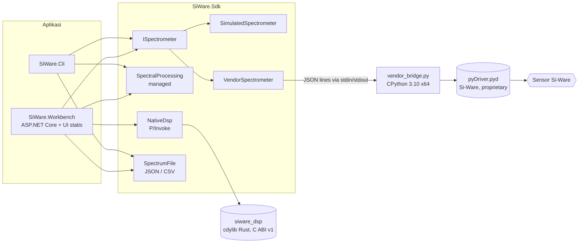

# Arsitektur

*SiWare.NET, dibuat oleh Gravicode Studios dipimpin oleh Kang Fadhil.* · [English](../en/architecture.md)

## Gambaran umum



SDK memisahkan tiga tanggung jawab:

| Tanggung jawab | Tipe | Catatan |
|---|---|---|
| **Transport / perangkat** | `ISpectrometer`, `SimulatedSpectrometer`, `VendorSpectrometer`, `ScanOptions`, `DeviceInfo` | Memegang koneksi, menjalankan operasi satu per satu, mendukung pembatalan |
| **Model data** | `Spectrum`, `MeasurementKind`, `SpectrumFile` | Immutable, divalidasi saat dibuat, membawa asal-usul data (provenance) |
| **Pemrosesan** | `SpectralProcessing`, `NativeDsp` | Fungsi murni dari spektrum ke spektrum baru |

## Model data

`Spectrum` adalah snapshot immutable: `Id`, `DeviceId`, `CapturedAt`, `Kind`, `IsSimulated`, `Wavelengths` (nanometer), dan `Values`. Konstruktornya menolak data yang tidak konsisten:

- 2 sampai 1.000.000 titik, dengan panjang gelombang dan nilai yang jumlahnya sama
- semua nilai hingga (finite), serta panjang gelombang positif dan naik secara ketat

Karena setiap `Spectrum` pasti valid, kode pemrosesan tidak perlu memeriksa ulang bentuk data. Array input disalin, sehingga pemanggil tidak dapat mengubah spektrum setelahnya. Pemrosesan selalu menghasilkan spektrum **baru** (`WithValues`) dengan perangkat dan provenance yang sama.

`MeasurementKind` membedakan hasil akuisisi mentah (`Sample`, `Dark`, `Reference`) dari hasil turunan (`Absorbance`, `Normalized`). Perangkat hanya menghasilkan jenis mentah.

**Provenance tidak pernah hilang.** `IsSimulated` ditetapkan oleh perangkat dan disalin oleh setiap langkah pemrosesan. Kalibrasi (`SpectralProcessing.Match`) menolak menggabungkan spektrum dari perangkat atau provenance yang berbeda, atau dengan grid panjang gelombang yang berbeda. CSV tidak memiliki kolom provenance, sehingga `SpectrumFile.FromCsv` mewajibkan pemanggil menyebutkan ID perangkat dan status simulasi secara eksplisit.

## Perangkat

Implementasi `ISpectrometer` menjaga setiap operasi dengan `SemaphoreSlim`, sehingga perangkat aman dipakai bersama meskipun operasinya berjalan satu per satu. Semua metode menerima `CancellationToken`.

- **`SimulatedSpectrometer`**: sinyal NIR sintetis yang deterministik (memakai seed) pada 1350–2550 nm, berisi profil lampu, tiga pita serapan pada 1450, 1940, dan 2310 nm, serta derau kecil. Waktu integrasi (sebagai jeda) dan perataan ikut diperhitungkan. Simulator ini alat bantu pengembangan, **bukan** emulator perangkat keras.
- **`VendorSpectrometer`**: adaptor untuk binding Python Si-Ware yang terpasang. Lihat [Integrasi vendor](vendor-integration.md).

### Mengapa memakai proses worker Python?

Inspeksi statis dan saat impor terhadap Si-Spect Platform (lihat `docs/research/`) menunjukkan bahwa driver vendor adalah **ekstensi native CPython 3.10** (`pyDriver.cp310-win_amd64.pyd`), bukan assembly .NET atau SDK C yang terdokumentasi. Protokol kabel dan tata letak paketnya tidak dipublikasikan, sehingga mengimplementasikannya ulang berarti menebak. Karena itu SDK memanggil binding vendor yang asli, yang dijalankan di proses terpisah:

- **Isolasi**: crash atau hang di kode native vendor tidak menjatuhkan proses .NET. Saat batas waktu habis atau terjadi galat, seluruh pohon proses worker dihentikan.
- **IPC terbatas**: satu objek JSON per baris, ID permintaan dicocokkan, batas baris 1 MiB, dan batas waktu yang dapat diatur (30–600 detik).
- **stdout bersih**: diagnostik vendor dialihkan ke stderr, lalu dibuang oleh .NET (log vendor dapat berisi konfigurasi lokal).
- **Tanpa tebakan**: satuan waktu pemindaian, nilai mode, dan satuan sumbu bilangan gelombang wajib dikonfirmasi pengguna di konfigurasi.

## Pemrosesan

| Operasi | Managed | Native (Rust) | Catatan |
|---|---|---|---|
| Absorbansi | `SpectralProcessing.Absorbance` | `NativeDsp.Absorbance` | `-log10((S-D)/(R-D))`, dihitung sebagai `log10(R-D) - log10(S-D)` untuk menghindari overflow rasio. Sinyal terkoreksi wajib positif |
| SNV | `SpectralProcessing.StandardNormalVariate` | `NativeDsp.StandardNormalVariate` | Simpangan baku sampel (N-1). Spektrum konstan ditolak. Diskalakan dengan nilai mutlak maksimum agar tetap dalam rentang numerik |
| Rata-rata bergerak | `SpectralProcessing.Smooth` | `NativeDsp.Smooth` | Jendela ganjil, dipotong di tepi; jumlah geser O(N) |

Metode `NativeDsp` **tidak pernah diam-diam beralih** ke kode managed. Jika library tidak ada atau versi ABI berbeda, metode tersebut melempar `PlatformNotSupportedException`. Pemanggil memilih secara eksplisit lewat `NativeDsp.IsAvailable`, seperti yang dilakukan Workbench.

### ABI Rust

`native/siware-dsp` adalah `cdylib` tanpa dependensi yang mengekspor `siware_dsp_abi_version` (saat ini `1`), `siware_dsp_snv`, `siware_dsp_smooth`, dan `siware_dsp_absorbance`. Deklarasi C ada di `include/siware_dsp.h`. Kontraknya:

- Kode status: `0` sukses, `1` argumen tidak valid, `2` nilai tak hingga atau galat domain
- Output hanya ditulis jika sukses (dihitung lebih dulu ke buffer sementara), dan tidak boleh tumpang tindih dengan input
- Buffer null, tidak sejajar, tumpang tindih, atau yang panjangnya overflow ditolak; panic ditangkap di batas ABI
- Tidak ada kepemilikan memori yang berpindah melintasi ABI, karena pemanggil mengalokasikan semua buffer

Jika ABI berubah, perbarui ekspor Rust, header, dan deklarasi `DllImport` bersamaan, lalu naikkan nomor versinya.

## Workbench

`SiWare.Workbench` adalah minimal API ASP.NET Core yang menyajikan UI statis tanpa dependensi (`wwwroot/`, JS murni + grafik SVG).

- **`WorkbenchSession`** (singleton) memegang `ISpectrometer`, kalibrasi dark/referensi saat ini, dan riwayat terbatas berisi 100 spektrum. Hanya satu akuisisi yang berjalan dalam satu waktu; permintaan tambahan mendapat `409`.
- **Pemilihan perangkat**: simulator, atau `VendorSpectrometer` bila `SIWARE_VENDOR_CONFIG` menunjuk ke berkas konfigurasi.
- **Pengamanan**: POST lintas origin ditolak (`403`), body permintaan dibatasi 64 KiB, `Content-Security-Policy` yang ketat melarang skrip dan gaya inline, dan `X-Content-Type-Options: nosniff` dipasang.
- **Pemetaan galat**: `KeyNotFoundException` → 404, `InvalidOperationException` / pembatalan → 409, `IOException` (galat perangkat atau worker) → 502, dan galat validasi → 400. Pembatalan sengaja tidak memakai `408`, karena browser otomatis mengirim ulang permintaan yang dijawab 408, sehingga akuisisi yang sudah dibatalkan akan berjalan lagi.
- **UI**: dwibahasa (EN/ID), kursor grafik yang dapat dikendalikan keyboard, responsif hingga lebar 390 px, dan lencana *DATA SIMULASI* / *PERANGKAT · BELUM DIVERIFIKASI* yang selalu tampil.

## Struktur repositori

```
src/SiWare.Sdk/            Library SDK (NuGet: Gravicode.SiWare.Sdk)
native/siware-dsp/         Crate DSP Rust, header C, tes Rust
samples/SiWare.Workbench/  Workbench web
samples/SiWare.Cli/        Contoh baris perintah
tests/SiWare.Sdk.Tests/    Tes xUnit (tanpa perangkat keras)
scripts/                   Jembatan dan probe vendor, smoke test UI, perender ikon dan tangkapan layar
docs/                      en/, id/, research/, screenshots/, assets/, nuget/
```

Pengaturan build bersama ada di `Directory.Build.props` (net10.0, nullable, peringatan sebagai galat). `Directory.Build.targets` menyalin library native ke output setiap proyek bila library tersebut sudah dibangun.
