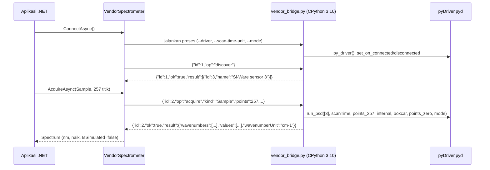

# Integrasi vendor

*SiWare.NET, dibuat oleh Gravicode Studios dipimpin oleh Kang Fadhil.* · [English](../en/vendor-integration.md)

> Jembatan ini memanggil driver Si-Ware **asli** yang terpasang. Penemuan perangkat dan akuisisi sudah divalidasi pada Si-NIR Matrix DVK lewat USB di Windows 10; akurasi pengukuran dan arti `mode` masih terbuka (lihat [Validasi perangkat keras](hardware-validation.md)). Workbench tetap memberi label *PERANGKAT · BELUM DIVERIFIKASI* sampai Anda melakukan uji akurasi sendiri.

## Cara kerja



Penemuan perangkat menunggu hingga 20 detik untuk callback koneksi dari driver, dan langsung selesai begitu sensor muncul. Sensor USB biasanya butuh sekitar 6 detik. `Sample` memakai `run_psd`. `Reference` memakai `run_background` lalu `read_background`. Pemindaian berulang hanya dirata-ratakan jika sumbu bilangan gelombangnya identik. Bilangan gelombang dalam cm⁻¹ dikonversi ke nanometer (`10^7 / ν`) lalu diurutkan naik.

Adaptor memilih gain optik internal, apodisasi boxcar, dan tanpa zero padding. Ini pilihan eksplisit, bukan nilai bawaan vendor. Binding **tidak memiliki operasi dark** (dikonfirmasi lewat analisis Ghidra, lihat [driver-ghidra.md](../research/driver-ghidra.md)). Sensor Si-Ware adalah instrumen Fourier-transform, sehingga spektrumnya tidak membawa offset dark. Karena itu sesi vendor menghitung absorbansi dari referensi saja dengan `SpectralProcessing.Absorbance(sample, reference)`, dan Workbench tidak menampilkan langkah dark untuk sesi tersebut.

## Prasyarat

1. **Si-Spect Platform** terpasang dari Si-Ware, yang menyediakan `C:\Program Files (x86)\Si-Spect Platform\Analyze\pyDriver.pyd`. Berkas ini tidak didistribusikan ulang di sini.
2. **CPython 3.10 x64**. Paket *embeddable* resmi dapat dipakai (`python-3.10.11-embed-amd64.zip` dari python.org). Ekstrak ke folder pilihan Anda.
3. **Proses .NET Windows x64.** Jembatan menolak platform lain dan proses 32-bit.
4. Sensor tersambung dan menyala, dengan driver USB atau jaringan dari vendor sudah terpasang. Pastikan dulu aplikasi Si-Spect dapat melihat sensor tersebut.

Periksa binding tanpa menyentuh perangkat:

```powershell
<python310>\python.exe scripts\vendor_bridge.py --self-test   # hanya protokol, tanpa mengimpor kode vendor
<python310>\python.exe scripts\vendor_probe.py --inspect      # mengimpor pyDriver, membaca metadata, tidak membuat driver
```

## Konfigurasi

Salin `scripts/vendor-config.example.json` lalu isi dengan path **absolut**:

```json
{
  "pythonExecutable": "C:\\tools\\python310\\python.exe",
  "workerScript": "C:\\src\\SiWare.Net\\scripts\\vendor_bridge.py",
  "driverModule": "C:\\Program Files (x86)\\Si-Spect Platform\\Analyze\\pyDriver.pyd",
  "scanTimeUnit": "seconds",
  "mode": 0,
  "confirmWavenumbersInInverseCentimeters": true,
  "deviceId": null,
  "timeoutSeconds": 60
}
```

| Field | Arti |
|---|---|
| `scanTimeUnit` | Gunakan `seconds`. Aplikasi vendor memberi label detik pada `scan_time`, dan semua pemindaian contohnya memakai 2 detik (bukti di [driver-ghidra.md](../research/driver-ghidra.md)). Pengaturan ini tetap eksplisit sampai diverifikasi pada sensor fisik. Dengan detik, `ScanOptions.IntegrationMilliseconds = 2000` sama dengan pemindaian 2 detik yang umum dipakai vendor. |
| `mode` | Bilangan bulat yang dikirim ke setiap panggilan `run_*`. Artinya masih **belum diketahui**: analisis statis mengaitkannya dengan format permintaan "default" dan "compatibility" pada driver, tetapi belum dengan nilai konkret. Konfirmasikan ke Si-Ware; nilai `0` belum terverifikasi. |
| `confirmWavenumbersInInverseCentimeters` | Wajib `true`, sebagai konfirmasi bahwa `wvn` dalam cm⁻¹ sebelum dikonversi ke nm. |
| `deviceId` | ID perangkat hasil penemuan (opsional). Jika `null`, perangkat pertama yang ditemukan dipakai. |
| `timeoutSeconds` | 30–600. Batas waktu per permintaan; penemuan perangkat saja bisa memakan hingga 20 detik. Saat batas waktu habis, worker dihentikan. |

Jika memakai paket NuGet, `vendor_bridge.py` disalin ke `<output>/SiWare/vendor_bridge.py`. Arahkan `workerScript` ke sana.

## Menghubungkan sensor

Driver berkomunikasi lewat TCP/IP: driver menemukan sensor dengan broadcast UDP di setiap antarmuka jaringan, lalu membuka koneksi TCP. Sensor USB muncul sebagai adaptor jaringan:

- **Si-NIR (USB RNDIS, VID 2D15 / PID F317):** pasang `driver\x64\Si-NIR.inf` dari folder Si-Spect. `install.bat`-nya mengatur adaptor host ke alamat statis `192.168.137.1/24`.
- **P10 / berbasis ESP (USB NCM, VID 303A / PID 4000):** pasang `driver\p10_x64\siwarenirusbdriver.inf`.
- Sensor yang terhubung lewat Wi-Fi cukup berada di jaringan yang bisa dijangkau. Izinkan broadcast UDP dan lalu lintas TCP driver di firewall Windows.

Binding vendor juga menyediakan operasi yang menulis kalibrasi (`burn_wln`, `burn_gain`, `burn_self`, `write_*`, `restore_default_correction`). **Jembatan tidak pernah memanggilnya**; jembatan hanya memakai penemuan perangkat, `run_psd`, `run_background`, dan `read_background`.

## Penggunaan

```csharp
var options = JsonSerializer.Deserialize<VendorBridgeOptions>(File.ReadAllText("vendor.json"), SpectrumFile.JsonOptions)!;
await using var device = new VendorSpectrometer(options);
await device.ConnectAsync();
var reference = await device.AcquireAsync(MeasurementKind.Reference, new ScanOptions(Points: 257));
var sample = await device.AcquireAsync(MeasurementKind.Sample, new ScanOptions(Points: 257));
```

```powershell
$env:SIWARE_VENDOR_CONFIG = "C:\path\vendor.json"; dotnet run --project samples/SiWare.Workbench
dotnet run --project samples/SiWare.Cli -- discover --vendor-config C:\path\vendor.json
dotnet run --project samples/SiWare.Cli -- scan --vendor-config C:\path\vendor.json --output sample.json
```

## Perilaku saat gagal

- **Setiap** permintaan yang gagal, dibatalkan, atau melewati batas waktu menghentikan seluruh pohon proses worker dan memutus koneksi. Panggil `ConnectAsync` lagi. Panggilan native vendor tidak dapat dihentikan dengan aman dengan cara lain.
- Respons diperiksa (ID permintaan, ID perangkat, satuan sumbu, jumlah titik, nilai hingga) sebelum `Spectrum` dibuat.
- Kode `Error` vendor yang bukan nol dilaporkan sebagai `IOException("Vendor operation failed with error code N")`.
- stderr worker (diagnostik vendor) dibaca lalu dibuang. Untuk debugging, jalankan `vendor_bridge.py` secara manual dan ketik permintaan JSON ke dalamnya.
