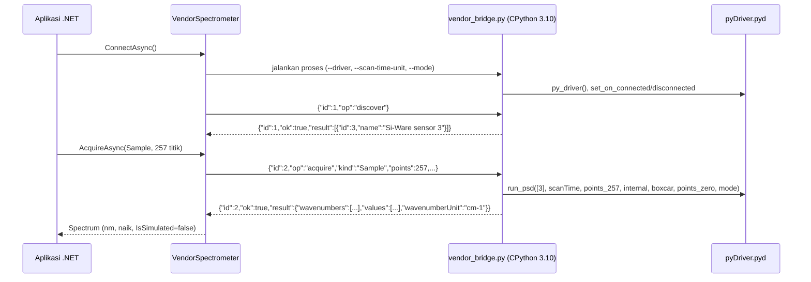

# Integrasi vendor

*SiWare.NET, dibuat oleh Gravicode Studios dipimpin oleh Kang Fadhil.* · [English](../en/vendor-integration.md)

> Jembatan ini memanggil driver Si-Ware **asli** yang terpasang, tetapi belum divalidasi dengan sensor fisik. Anggap hasil pembacaan belum terverifikasi sampai daftar periksa di [Validasi perangkat keras](hardware-validation.md) selesai. Workbench memberi label *PERANGKAT · BELUM DIVERIFIKASI* untuk sesi seperti ini.

## Cara kerja



Penemuan perangkat menunggu hingga 5 detik untuk callback koneksi dari driver. `Sample` memakai `run_psd`. `Reference` memakai `run_background` lalu `read_background`. Pemindaian berulang hanya dirata-ratakan jika sumbu bilangan gelombangnya identik. Bilangan gelombang dalam cm⁻¹ dikonversi ke nanometer (`10^7 / ν`) lalu diurutkan naik.

Adaptor memilih gain optik internal, apodisasi boxcar, dan tanpa zero padding. Ini pilihan eksplisit, bukan nilai bawaan vendor. Akuisisi dark **tidak** didukung karena tidak ditemukan operasi dark pada binding. Akibatnya, Workbench menonaktifkan perekaman Dark, dan dengan demikian juga Absorbansi, pada sesi vendor.

## Prasyarat

1. **Si-Spect Platform** terpasang dari Si-Ware, yang menyediakan `C:\Program Files (x86)\Si-Spect Platform\Analyze\pyDriver.pyd`. Berkas ini tidak didistribusikan ulang di sini.
2. **CPython 3.10 x64**. Paket *embeddable* resmi dapat dipakai (`python-3.10.11-embed-amd64.zip` dari python.org). Ekstrak ke folder pilihan Anda.
3. **Proses .NET Windows x64.** Jembatan menolak platform lain dan proses 32-bit.
4. Sensor tersambung dan menyala, dengan driver USB atau jaringan dari vendor sudah terpasang. Pastikan dulu aplikasi Si-Spect dapat melihat sensor tersebut.

Periksa binding tanpa menyentuh perangkat:

```powershell
<python310>\python.exe scripts\vendor_bridge.py --self-test   # hanya protokol, tanpa mengimpor kode vendor
<python310>\python.exe scripts\vendor_probe.py --inspect      # mengimpor pyDriver, membaca metadata, tidak membuat driver
```

## Konfigurasi

Salin `scripts/vendor-config.example.json` lalu isi dengan path **absolut**:

```json
{
  "pythonExecutable": "C:\\tools\\python310\\python.exe",
  "workerScript": "C:\\src\\SiWare.Net\\scripts\\vendor_bridge.py",
  "driverModule": "C:\\Program Files (x86)\\Si-Spect Platform\\Analyze\\pyDriver.pyd",
  "scanTimeUnit": "milliseconds",
  "mode": 0,
  "confirmWavenumbersInInverseCentimeters": true,
  "deviceId": null,
  "timeoutSeconds": 60
}
```

| Field | Arti |
|---|---|
| `scanTimeUnit` | `milliseconds` atau `seconds`: satuan `scan_time` yang diharapkan driver. Binding tidak mendokumentasikannya, jadi **konfirmasikan ke dokumentasi Si-Ware**. Berkas contoh sengaja berisi nilai placeholder yang tidak valid. |
| `mode` | Bilangan bulat yang dikirim ke setiap panggilan `run_*`. Artinya tidak terdokumentasi; konfirmasikan ke Si-Ware. |
| `confirmWavenumbersInInverseCentimeters` | Wajib `true`, sebagai konfirmasi bahwa `wvn` dalam cm⁻¹ sebelum dikonversi ke nm. |
| `deviceId` | ID perangkat hasil penemuan (opsional). Jika `null`, perangkat pertama yang ditemukan dipakai. |
| `timeoutSeconds` | 6–600. Batas waktu per permintaan. Saat batas waktu habis, worker dihentikan. |

Jika memakai paket NuGet, `vendor_bridge.py` disalin ke `<output>/SiWare/vendor_bridge.py`. Arahkan `workerScript` ke sana.

## Penggunaan

```csharp
var options = JsonSerializer.Deserialize<VendorBridgeOptions>(File.ReadAllText("vendor.json"), SpectrumFile.JsonOptions)!;
await using var device = new VendorSpectrometer(options);
await device.ConnectAsync();
var reference = await device.AcquireAsync(MeasurementKind.Reference, new ScanOptions(Points: 257));
var sample = await device.AcquireAsync(MeasurementKind.Sample, new ScanOptions(Points: 257));
```

```powershell
$env:SIWARE_VENDOR_CONFIG = "C:\path\vendor.json"; dotnet run --project samples/SiWare.Workbench
dotnet run --project samples/SiWare.Cli -- discover --vendor-config C:\path\vendor.json
dotnet run --project samples/SiWare.Cli -- scan --vendor-config C:\path\vendor.json --output sample.json
```

## Perilaku saat gagal

- **Setiap** permintaan yang gagal, dibatalkan, atau melewati batas waktu menghentikan seluruh pohon proses worker dan memutus koneksi. Panggil `ConnectAsync` lagi. Panggilan native vendor tidak dapat dihentikan dengan aman dengan cara lain.
- Respons diperiksa (ID permintaan, ID perangkat, satuan sumbu, jumlah titik, nilai hingga) sebelum `Spectrum` dibuat.
- Kode `Error` vendor yang bukan nol dilaporkan sebagai `IOException("Vendor operation failed with error code N")`.
- stderr worker (diagnostik vendor) dibaca lalu dibuang. Untuk debugging, jalankan `vendor_bridge.py` secara manual dan ketik permintaan JSON ke dalamnya.
