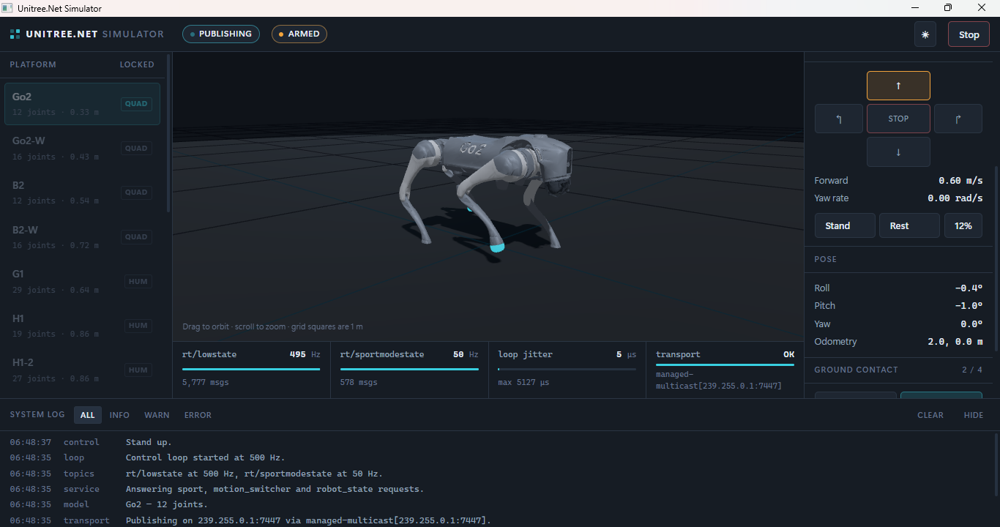
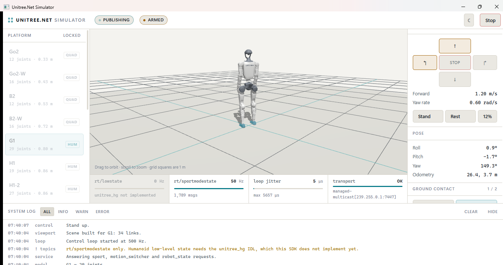
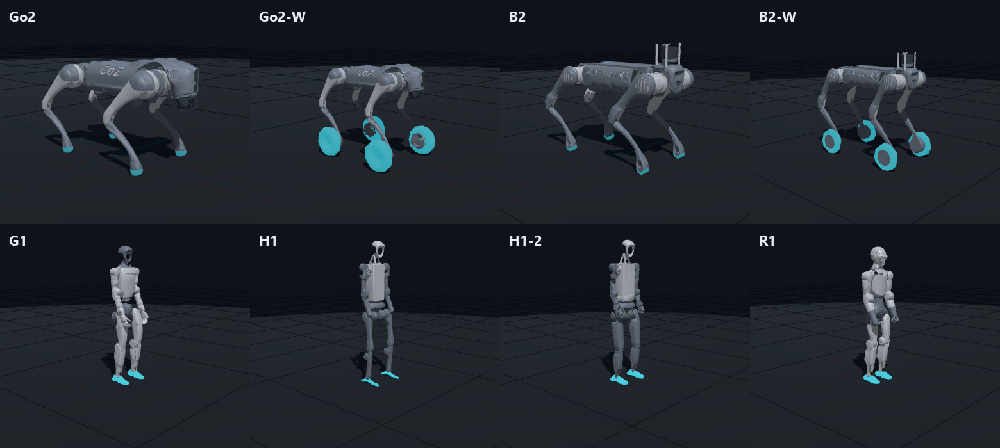
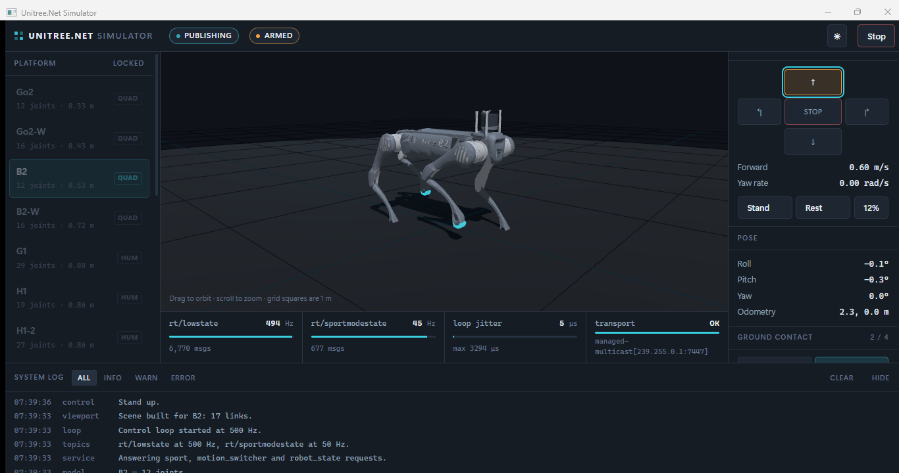

# Robot simulator

`apps/Unitree.Net.Simulator` is a desktop simulator with a 3D viewport. It publishes real telemetry
over the SDK's own transport, so anything downstream of the robot — the CLI, the dashboard, your own
application — connects to it exactly as it would to hardware.

```bash
dotnet run --project apps/Unitree.Net.Simulator
```

Pick a platform, press **Start simulation**, and point anything at the same multicast group:

```bash
dotnet run --project apps/Unitree.Net.Cli -- status
dotnet run --project apps/Unitree.Net.Cli -- monitor
dotnet run --project apps/Unitree.Net.Dashboard     # http://localhost:5101
```

The dashboard works against it in full, control page included: its posture buttons and drive pad reach
the simulated robot the same way they would reach hardware. Nothing needs configuring — both default to
`239.255.0.1:7447`.



## What it is

Eight platforms are modelled: Go2, Go2-W, B2, B2-W, G1, H1, H1-2 and R1. Each has an articulated rig
drawn from its real proportions and driven by a gait — a diagonal trot for the quadrupeds, an
alternating walk with counter-swinging arms for the humanoids.

It also **answers the robot's services**, not just publishes telemetry. `sport`, `motion_switcher` and
`robot_state` all respond on their `rt/api/<service>/request` topics, so an application can stand the
robot up, drive it and stop it exactly as it would a real one.

**The robot starts resting, as it does after power-on, and refuses to drive until it has been stood
up.** That is deliberate. Standing it up automatically would let an application skip `StandUpAsync`
and `BalanceStandAsync` and still work here — and then fail silently on hardware, which is precisely
the trap this simulator exists to expose.

Tricks the simulator cannot animate — flips, pounces, dances — are accepted rather than refused.
Refusing them would make the simulator look broken when the application is fine.

| Panel | What it shows |
|---|---|
| Platform | Model picker, multicast group and port, publish rate |
| Viewport | The robot, driven from live joint angles. Drag to orbit, scroll to zoom |
| Status | Battery, hottest motor, pose, per-foot contact force |
| Drive | Velocity pad, stand/rest, and a control that forces the battery low |
| Telemetry ribbon | Each topic's **measured** rate, message count and loop jitter |
| System log | Lifecycle, transport and any JavaScript error from the viewport |

The ribbon reports measured rates rather than configured ones. The difference between the two is
exactly what you want to see when a loop is struggling.

## What it is not

**It is not a physics simulator.** Motion is generated, not integrated: legs follow a phase-driven
gait, the body rides on top of the legs, and the battery discharges on a timer. Nothing here will tell
you whether a controller is stable. For real dynamics, drive Isaac Lab or Gazebo and publish its state
through the same transport.

The point is telemetry with realistic *shape* — values that move, correlate and cross thresholds — so
that everything above the robot can be developed honestly.

## Humanoids publish less



Quadrupeds publish `rt/lowstate` and `rt/sportmodestate`. Humanoids publish **only**
`rt/sportmodestate`, and the ribbon greys the other lane out and says why.

Humanoid low-level state belongs to the `unitree_hg` IDL, which this SDK does not implement yet. A
quadruped-shaped `LowState` labelled G1 would be worse than nothing, because it would look like it
worked.

## The rig is one description

A rig is a tree of links: a name, a parent, an offset, a rotation axis, a joint index, and the shapes
drawn in its frame. The viewport turns each link into a nested scene-graph node, which means Three.js
performs the forward kinematics and `viewport.js` never multiplies a transform itself.

The same rig drives the simulation. That is deliberate — the geometry you see and the geometry that
walks are the same description, so they cannot drift apart.

`RobotRig` asserts that the links it built account for exactly the joints the platform claims to have.
That check caught H1 being modelled with 21 joints: its ankle is pitch-only and its arms have no
wrists, which is what makes it 19.

Frames follow Unitree's convention — x forward, y left, z up. The whole robot hangs under one group
rotated −90° about x, mapping `(x, y, z)` to `(x, z, −y)`, so rig numbers are used verbatim in metres.

## Manufacturer meshes

All eight platforms are drawn from Unitree's own visual meshes, taken from
[`unitree_ros`](https://github.com/unitreerobotics/unitree_ros): `go2_description`, `b2_description`,
`b2w_description`, `g1_description/g1_29dof_rev_1_0.urdf`, `h1_description`,
`h1_2_description/h1_2_handless.urdf` and `r1_description`. Go2-W's calves and wheels come from
[`unitree_mujoco`](https://github.com/unitreerobotics/unitree_mujoco), because `go2w_description`
references DAE files it does not ship.



**A mesh is decoration, not description.** `RigLink.Mesh` names a GLB file; the link's `Shapes` stay
the rig's geometry. The viewport draws the primitives at once, loads the meshes in the background, and
swaps them in — all of a robot's or none of them. If one file fails, every primitive stays and the
reason goes to the system log. A robot that is half mesh and half box looks broken in a way that hides
which file is missing. Once they are in, every primitive is hidden, including those on links with no
mesh of their own: B2's calf mesh already ends in its foot, and the foot sphere would sit inside it.

**The rig's link frames are the URDF's own.** Go2's hip, thigh, calf and foot sit at the same origins as
in `go2_description.urdf` (hips at ±0.1934 / ±0.0465, thigh 0.0955 out, 0.213 segments), so a URDF
visual hangs off the matching link unmodified. The only per-link data is the URDF's visual origin: the
right-hand thigh and calf use mirrored meshes, and the single hip mesh is flipped about X on the right
and about Y at the rear. `RobotRigTests` pins those four rotations. B2 ships a separate mesh for every
leg and needs no flips; its rig was corrected to the URDF on the way (hips at x = 0.3285, not 0.3455).

The wheeled variants share their walking sibling's body, hip and thigh meshes and frames, and add
calves and wheels of their own. Go2-W's axle sits 0.2264 below the knee, not 0.213, and its wheels are
0.088 in radius; B2-W's are 0.112. The radius is what turns ground speed into wheel spin, so it comes
from the meshes rather than a guess.



**Every humanoid is a transcription of its URDF, fixed rotations included.** Some joint origins are
rotated as well as offset — G1's hip roll and knee by ±0.1749 rad, R1's hips by ±0.436, every
platform's shoulders by ±0.26–0.44. `RigLink.Rotation` carries that `rpy`, and the viewport turns each
joint about its axis inside it. `tools/meshes/urdf_to_rig.py` prints the rows from the URDF;
`HumanoidForwardKinematicsMatchTheUrdf` chains each rig at zero and checks feet, hands and R1's head
against positions computed from the URDF in Python. Drop one fixed rotation and they move by
centimetres.

Transcribing the URDFs corrected the platforms, not just their looks. H1's hip chain runs yaw, roll,
pitch; H1-2's runs yaw, pitch, roll. R1 was modelled with a two-axis waist and six-joint arms, when its
URDF has a waist that rolls then yaws, five-joint arms ending in a wrist roll, and a two-axis head; the
joint count was 26 either way, which is why nothing caught it. Link names did not change where the
gait looks them up, and joint indices follow URDF order — `unitree_hg`'s for G1. The others have no SDK
index table yet, because their low-level state is not implemented.

Every URDF's zero pose holds the forearms out in front, elbows at a right angle. The neutral pose
lowers them by 0.8 rad, and the gait's elbow swing is added to the neutral rather than replacing it.

**Colours come from the theme, not the file.** The converter tags each part by the luminance of its
source colour as `shell`, `limb` or `contact`, and the viewport paints those roles exactly as it paints
the primitives, so the light/dark switch reaches the meshes too. The calf's rubber tip is `contact`,
which is why the whole foot pad lights when that foot is loaded. A wheel is all `contact` and always
loaded, so the wheeled variants' wheels stay lit while they stand or roll.

Why not [`unitree_model`](https://github.com/unitreerobotics/unitree_model)? It holds USD files for
Isaac Sim, which three.js cannot read reliably. It is deprecated in favour of Hugging Face, and its
own README says its models are generated from `unitree_ros`'s URDFs. `unitree_ros` is the source.

### Converting a platform

```bash
pip install trimesh pycollada fast_simplification numpy scipy
python tools/meshes/convert_meshes.py <unitree_ros>/robots/go2_description/dae \
    apps/Unitree.Net.Simulator/wwwroot/models/go2 \
    base=14000 hip=5000 thigh=5000 thigh_mirror=5000 calf=2500 calf_mirror=2500 foot=800
```

The budgets are triangle counts. Go2's DAE files total 26 MB and 197 k triangles; at these budgets they
come to 1.4 MB and 38 k. Each colour group is decimated on its own, so two-tone panels keep their
boundary. B2 and G1 come to 3.2 MB each.

G1's meshes are STL, which has no colour. The role then comes from the URDF's material name — `white`
is `shell`, `dark` is `limb`, and the feet are `contact` so they light on load — and is given per file
with `@role`. Files that sit at the same URDF origin are merged with `+`:

```bash
python tools/meshes/convert_meshes.py <unitree_ros>/robots/g1_description/meshes \
    apps/Unitree.Net.Simulator/wwwroot/models/g1 \
    pelvis:pelvis+pelvis_contour_link=4000@limb head:head_link+logo_link=4000@limb \
    torso_link_rev_1_0=8000@shell left_knee_link=4000@shell left_ankle_roll_link=2000@contact ...
```

H1, H1-2 and R1 colour every part alike in the URDF (H1 is 0.1 grey throughout), so luminance cannot
tell body from limb. Their roles are set per file: the torso is `shell` so it reads as the body.

For a quadruped, set the platform's `MeshSet` in `RobotRig` and check every link's frame against the
URDF's. For a humanoid, generate its rows and pin them with forward kinematics:

```bash
python tools/meshes/urdf_to_rig.py <unitree_ros>/robots/r1_description/R1.urdf names_r1.py
```

`EveryMeshTheRigNamesShipsWithTheSimulator` fails on any asset name with no file behind it. The
meshes are BSD-3-Clause; `wwwroot/models/LICENSE.unitree_ros` and `LICENSE.unitree_mujoco` carry the
notices and must ship with them.

## Adding a platform

1. Add the model to `RobotModel` in `Unitree.Net.Core`, with its joint count in `RobotModelInfo`.
2. Add a spec and a case to `RobotRig.For`, and add the model to `RobotRig.SupportedModels`.
3. Run the tests. `RobotRigTests` checks the joint count, that every joint index is driven by exactly
   one link, that parents appear before children, and that rotation axes are unit vectors.

Nothing in the viewport needs changing — it builds whatever rig it is handed.

## Using the engine without the window

The simulation is `src/Unitree.Net.Simulation`, plain `net10.0` with no UI dependency. The WPF shell is
only a host. To publish telemetry from a test, a service or a Linux box:

```csharp
var log = new SimulationLog();
await using var host = new SimulationHost(log);

await host.StartAsync(new SimulationOptions
{
    Model = RobotModel.Go2,
    MulticastAddress = "239.255.0.1",
    MulticastPort = 7447,
    LowStateRateHz = 500,
});

host.Robot.StandUp();
host.Robot.Command = new SimulatedVelocity(0.6f, 0f, 0.1f);
```

`samples/Unitree.Net.Samples.VirtualRobot` is the headless equivalent and needs no Windows.

## Platform note

The shell is WPF and therefore Windows-only; it needs the WebView2 runtime, which ships with Windows
11. The simulation engine underneath is cross-platform, which is the part that matters for a Jetson or
a Raspberry Pi.

## Measured

500 Hz requested gave 500 Hz actual at 3 µs mean jitter on a developer laptop, with the viewport
running. See `PROGRESS.md`.

---

Dibuat oleh **Gravicode Studios**, dipimpin **Kang Fadhil**.
